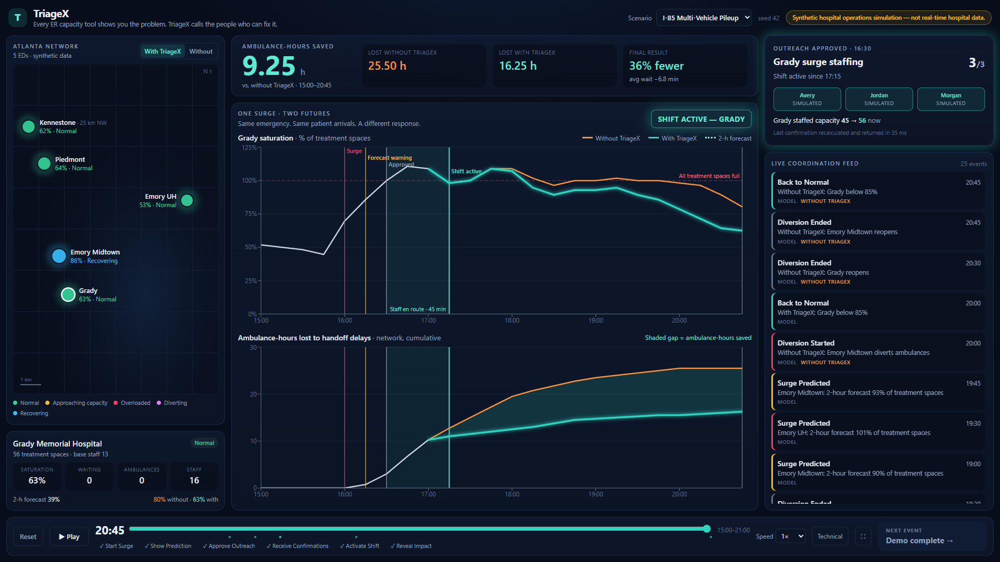
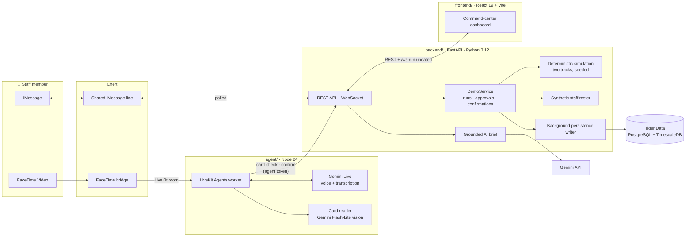
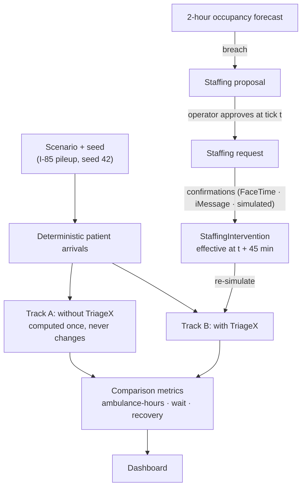
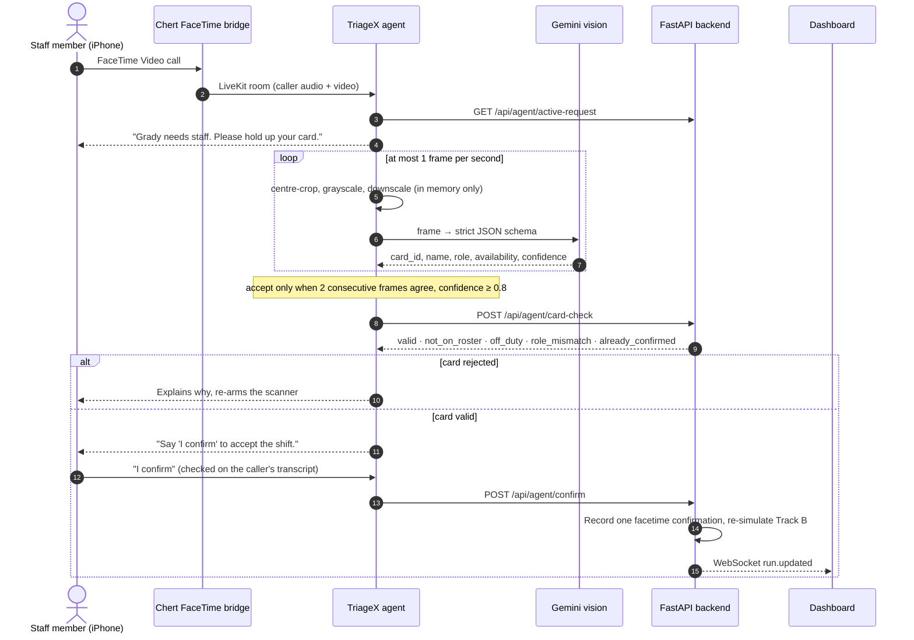
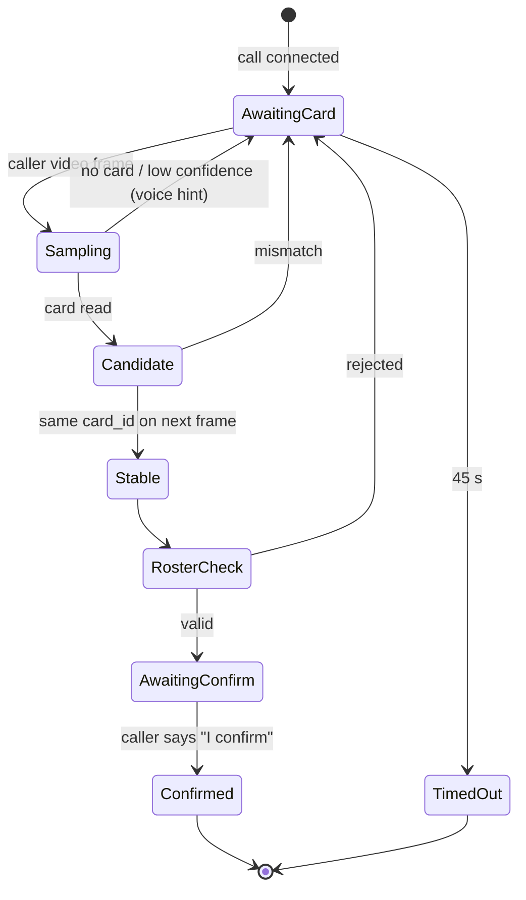
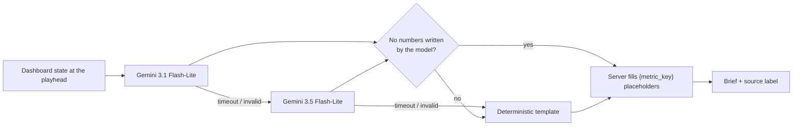
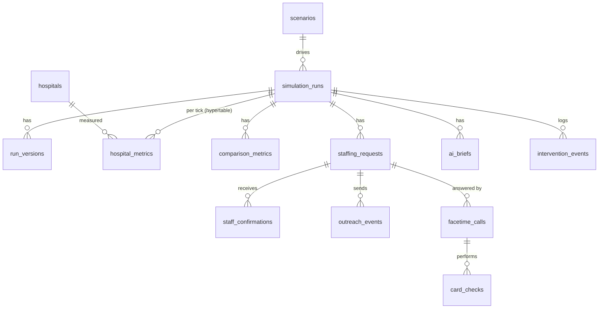
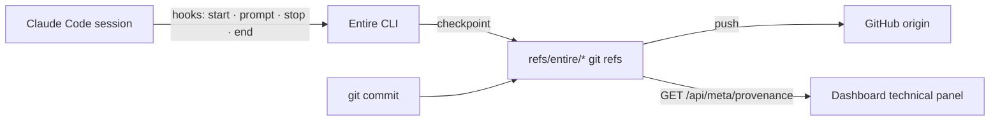

<div align="center">

# TriageX

### Every ER capacity tool shows you the problem. TriageX calls the people who can fix it.

*One surge. Two futures.*

🏆 **Winner: Best Use of Entire, Emory Hacks 2026**


[What it does](#what-it-does) · [Architecture](#architecture) · [Built with Entire](#built-with-entire) · [How it works](#how-it-works) · [Quick start](#quick-start) · [Docs](#documentation)



</div>

> [!IMPORTANT]
> **Synthetic hospital operations simulation, not real-time hospital data.** Hospital names and
> locations are used only for geographic context. Every operational figure, patient, staff member
> and staff card is synthetic or fictional. No hospital has supplied data to, approved, or partnered
> with this project, and TriageX is not a clinically validated operations platform. No camera image
> and no phone number is ever stored.

---

## The problem

When a highway pileup sends a wave of ambulances to one emergency department, the dashboards turn
red, and then a charge nurse starts phoning people. Capacity tools are good at *showing* the surge.
The step that changes the outcome, getting qualified staff on the floor in time, still runs on
phone trees.

TriageX connects the forecast to the response. It predicts the surge, proposes a staffing
intervention, waits for a human to approve it, reaches staff over **FaceTime** and **iMessage**,
verifies who answered, and shows what that response is worth by running the same emergency twice.

## What it does

| | Step | What happens |
|---|---|---|
| 1 | **Predict** | A deterministic simulation of five Metro Atlanta EDs runs an I-85 pileup and forecasts each hospital's occupancy two hours ahead. Where the forecast breaches capacity, TriageX proposes calling in staff. |
| 2 | **Approve** | Nothing is automatic. An operator approves the proposal, which starts a realistic 45-minute staffing lead time. |
| 3 | **Verify on FaceTime** | A staff member FaceTimes the TriageX line. The agent explains the request and asks them to hold up their staff card. It reads the card from the **live caller video**; the backend checks it against the roster. Unknown or off-duty cards are rejected out loud. A valid card counts only after the caller says *"I confirm"*. |
| 4 | **Compare two futures** | Same patients, same emergency. One future without TriageX, one with the confirmed staff arriving at 17:15. |
| 5 | **Brief** | Staff can also confirm by replying `IN` over iMessage, and a grounded AI brief summarizes the situation using only numbers the simulation produced. |

### Result on the I-85 pileup scenario (seed 42)

| Metric | Without TriageX | With TriageX | Change |
|---|---:|---:|---:|
| Ambulance-hours lost to handoff delays (15:00–20:45) | 25.50 h | **16.25 h** | **−9.25 h (−36%)** |
| Focus hospital recovery | | **45 min sooner** | |
| Confirmation → dashboard update | | **< 100 ms** | |

## Architecture



| Component | Stack | Path |
|---|---|---|
| Simulation engine | Pure Python, tick-based (15-min ticks), seeded, two tracks | [backend/app/simulation/](backend/app/simulation/) |
| API and demo state | FastAPI, Pydantic, WebSocket broadcast | [backend/app/api/](backend/app/api/), [backend/app/services/](backend/app/services/) |
| Persistence | Background thread, batched SQL, pure-Python `pg8000` driver | [backend/app/repositories/](backend/app/repositories/), [db/migrations/](db/migrations/) |
| Dashboard | React 19, TypeScript, Vite 8, Tailwind 4, Recharts 3 | [frontend/src/](frontend/src/) |
| FaceTime agent | Node 24, LiveKit Agents, Gemini Live, Gemini vision | [agent/](agent/) |
| Integrations | Chert FaceTime API, Chert iMessage, Gemini API | [backend/app/integrations/](backend/app/integrations/) |

## How it works

### One surge, two futures

The engine runs the same seeded arrival stream through two tracks. The baseline track never
changes. A confirmation re-simulates **only** the TriageX track, and confirmed staff take effect
at the approval tick plus 45 simulated minutes, so history before that point is identical in both
futures.



| Event (I-85 scenario) | Simulated time |
|---|---|
| Surge predicted | 16:15 |
| Outreach approved | 16:30 |
| Staff en route (lead-time band) | 16:30–17:15 |
| Shift active, futures diverge | 17:15 |

### FaceTime staff verification

The model only extracts fields. Every decision that matters is made by deterministic code: card
validity by the backend, and the confirmation by matching the caller's own transcribed words.



### Card-reader states



### Grounded AI brief

The language model never writes a number. Gemini returns text with `{metric_key}` placeholders,
the server fills in every value from the simulation, and any digit or spelled-out number in the
model output is rejected. The chain falls back from the primary model to a second model and then
to a deterministic template, and the dashboard shows which one produced the brief.



### Data model

Every run is stored in Tiger Data. Per-tick hospital metrics live in a TimescaleDB hypertable.



## Built with Entire

TriageX was built phase by phase with Claude Code, and [Entire](https://entire.io) recorded every
session as a checkpoint linked to the commits it produced. The reasoning behind the code is
versioned alongside the code, so anyone can see why a change was made, not just what changed.



- **Checkpoints stored as git refs** (`.entire/settings.json`, `"type": "git-refs"`) and pushed to
  `origin` with the code, so no separate service is needed to read them.
- **Automatic capture.** Claude Code hooks in [.claude/settings.json](.claude/settings.json) call
  `entire` at session start, on each prompt, on stop and at session end.
- **Provenance in the product.** `GET /api/meta/provenance`
  ([backend/app/api/meta.py](backend/app/api/meta.py)) reports the running commit and the Entire
  checkpoint refs, and the dashboard's technical panel shows them during the demo.
- **Handoffs that keep context.** A teammate continuing on another machine fetches the history and
  can ask what any past session did:

```bash
git fetch origin 'refs/entire/*:refs/entire/*'
entire checkpoint list
entire checkpoint explain <id>
```

## Design principles

- **Human in the loop.** The system proposes; a person approves. No outreach is sent without it.
- **Deterministic where it matters.** Same seed, same result. The baseline is provably unchanged by
  any confirmation.
- **Don't trust the model.** Vision needs two agreeing frames, validity is decided by the backend,
  confirmation needs the caller's own words, and the brief cannot write a number.
- **Privacy by default.** Frames are processed in memory and never written to disk. Phone numbers
  are never stored.
- **Degrade honestly.** Every integration runs without its keys and reports `not_configured`
  rather than pretending to be healthy. Simulated replies are always labeled as simulated.

## Quick start

### Try the simulation (no keys needed)

```bash
cd backend
uv run python -m app.simulation.cli i85_pileup --seed 42
uv run python -m app.simulation.cli heat_wave --seed 7 --staff 0 --no-level-loading
```

Scenarios: `i85_pileup`, `big_game`, `heat_wave`, `respiratory_wave`.

### Prerequisites

- [uv](https://docs.astral.sh/uv/) (installs Python 3.12 for the backend)
- **Node.js 24** (on macOS, put `/opt/homebrew/opt/node@24/bin` first on `PATH`; Homebrew's Node 25 is broken)
- For the FaceTime agent: an iPhone verified for a Chert project, and the Chert CLI via
  `npx @trychert/facetime@0.1.0-beta.21`

### Setup

```bash
cp .env.example .env
cp agent/.env.example agent/.env.local && chmod 600 agent/.env.local
(cd backend && uv sync)
(cd frontend && npm install)
(cd agent && npm install)
```

<details>
<summary><b>Environment variables</b></summary>

Never commit keys. Every integration works without its keys and says so.

| File | Variable | Purpose |
|---|---|---|
| `.env` | `DATABASE_URL` | Tiger Data connection string (optional; in-memory without it) |
| `.env` | `TRIAGEX_AGENT_TOKEN` | Shared secret with the agent (`openssl rand -hex 32`) |
| `.env` | `GEMINI_API_KEY` | AI operational brief |
| `.env` | `CHERT_API_KEY`, `CHERT_PROJECT_ID`, `CHERT_LINE_ID` | iMessage (`cd backend && uv run python ../scripts/chert_inspect.py`) |
| `.env` | `DEMO_ALLOWED_PHONES` | Allow-list for outbound demo messages |
| `agent/.env.local` | LiveKit keys | LiveKit Cloud project |
| `agent/.env.local` | `GOOGLE_API_KEY` | Gemini Live voice and card vision |
| `agent/.env.local` | `TRIAGEX_AGENT_TOKEN`, `AGENT_NAME` | Backend auth and agent registration |

</details>

### Run

```bash
# 1. API             → http://127.0.0.1:8000/docs
cd backend && uv run uvicorn app.main:app --host 127.0.0.1 --port 8000

# 2. Dashboard       → http://localhost:5173
cd frontend && npm run dev

# 3. FaceTime agent
cd agent && npm start

# 4. Chert bridge
cd agent && npx --yes @trychert/facetime@0.1.0-beta.21 dev --agent triagex-facetime-agent --minutes 30
```

The dashboard proxies `/api` and `/ws` to `127.0.0.1:8000`. Stop `chert dev` only with Ctrl+C and
wait for "Stopped". On Windows, [scripts/dev.ps1](scripts/dev.ps1) starts the backend and the
dashboard. Without the agent, the dashboard offers clearly labeled simulated replies.

### Test

```bash
cd backend  && uv run pytest -q && uv run ruff check .   # DB tests start a local PostgreSQL
cd frontend && npm test && npm run lint && npm run build
cd agent    && npm test
```

<details>
<summary><b>End-to-end rehearsal</b></summary>

Needs the backend and `npm run dev` running (Chrome on macOS, Edge elsewhere).

```bash
cd frontend
npm run rehearse -- /tmp/rehearsal 1366 768                          # simulated replies
REHEARSE_CONFIRM=agent npm run rehearse -- /tmp/rehearsal 1366 768   # agent API, no phone
REHEARSE_CONFIRM=live  npm run rehearse -- /tmp/rehearsal 1366 768   # waits for a real call / iMessage
```

</details>

## Status

| Area | State |
|---|---|
| Deterministic surge simulation | ✅ Complete, tested |
| FastAPI API + WebSocket, command-center dashboard | ✅ Complete, tested |
| Tiger Data persistence (TimescaleDB hypertable) | ✅ Migrations 001–005 applied to a live service |
| FaceTime agent with real caller video | ✅ Verified on real calls |
| Staff-card reading from live FaceTime video | ✅ Verified (5 cards read exactly; blank page → no card) |
| Card → roster → "I confirm" → dashboard | ✅ Verified on a live call with a valid card |
| Grounded AI brief | ✅ Verified against the real Gemini API |
| iMessage on the Chert shared line | ⚠️ Built and tested; live send limited by the Chert free trial |

Evidence and call logs: [docs/chert-status.md](docs/chert-status.md).

## Repository layout

```
TriageX/
├── backend/            FastAPI app, simulation engine, integrations, tests (Python 3.12, uv)
│   └── app/
│       ├── simulation/     engine, arrivals, forecast, interventions, metrics, scenarios
│       ├── api/            REST routes and WebSocket
│       ├── services/       demo state, dashboard model, outreach, FaceTime, brief
│       ├── integrations/   Chert clients
│       ├── repositories/   persistence, migrations, queries
│       └── data/           synthetic staff roster
├── frontend/           React + TypeScript + Vite + Tailwind dashboard
├── agent/              Chert FaceTime agent (LiveKit Agents, Gemini Live, Gemini vision)
├── db/migrations/      Plain SQL migrations for Tiger Data
├── docs/               API, database, assumptions, demo script, status, handoff
└── scripts/            Dev, migration and verification scripts
```

## Documentation

| Document | Contents |
|---|---|
| [docs/api.md](docs/api.md) | API contract, endpoints, latency measurements |
| [docs/database.md](docs/database.md) | Tiger Data setup and schema |
| [docs/assumptions.md](docs/assumptions.md) | Modeling assumptions and limitations |
| [docs/demo-script.md](docs/demo-script.md) | The 90-second demo |
| [docs/chert-status.md](docs/chert-status.md) | FaceTime and iMessage verification evidence |
| [docs/devpost.md](docs/devpost.md) | Project write-up |
| [docs/TriageX_Developer_Handoff.md](docs/TriageX_Developer_Handoff.md) | Full developer handoff |
| [agent/README.md](agent/README.md) | FaceTime agent internals |

## What's next

- The agent places the call itself (outbound FaceTime) the moment an operator approves.
- QR codes on staff cards as a deterministic second signal.
- Integration with real rosters and shift systems, with stronger identity verification.
- Patient-facing navigation, deliberately cut from this MVP.

## Built with

Python · FastAPI · Pydantic · uv · React · TypeScript · Vite · Tailwind CSS · Recharts ·
Tiger Data (PostgreSQL, TimescaleDB) · Chert FaceTime API · Chert iMessage · LiveKit Agents ·
Gemini Live · Gemini API · Playwright · Node.js

<div align="center">
<sub>Built at Emory Hacks 2026 · Winner, Best Use of Entire</sub>
</div>
