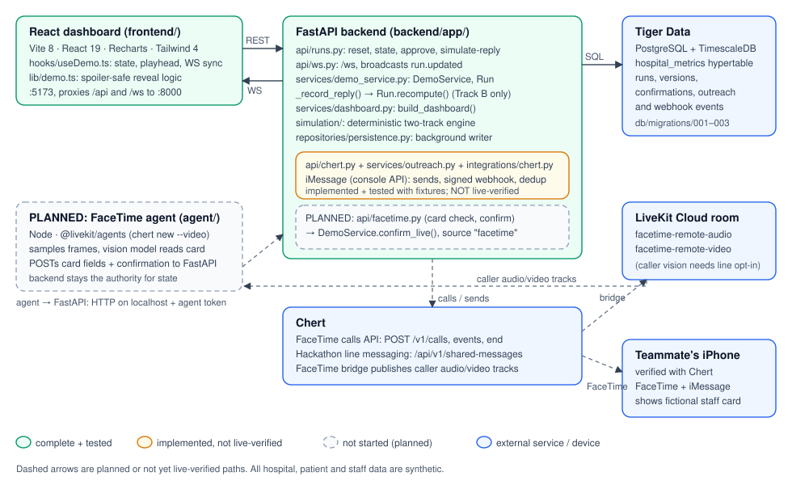
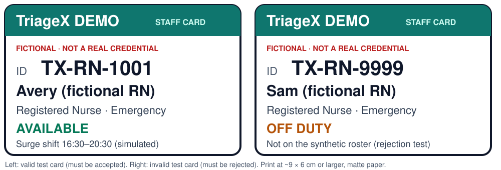

# TriageX — Developer Handoff & Claude Code Implementation Playbook

**Every ER capacity tool shows you the problem. TriageX calls the people who can fix it.**

*One surge. Two futures.*

| | |
|---|---|
| Repository | `https://github.com/mustafadev123/TriageX` (branch `main`) |
| Code baseline audited | `8c3be995d0d4073e8af745bdc93c92d4b415ec68` (`8c3be99`, 2026-11-14). Later commits change documentation only. |
| Audience | A teammate continuing development on **macOS** with **Claude Code** and an **iPhone** |
| Target | EmoryHacks 2026 Healthcare Track, plus the **Chert Best Use of FaceTime** sponsor prize |
| Data | **Everything is synthetic.** No real hospital, patient or staff data exists anywhere in this project. |

> **How to use this document.** Read Sections 1–9 once. Then work through the stages in Section 10
> in order. For each stage, paste the matching prompt from Section 11 into a **fresh** Claude Code
> session opened in the repository root. Each prompt is self-contained and ends with a stop
> condition. Do not skip a stage whose prerequisites are not verified.

---

## Contents

1. Executive summary
2. Current project status (audited)
3. Product and hackathon positioning
4. System architecture
5. Completed work by phase
6. Chert sponsor-prize strategy
7. Chert integration: what exists and what must change
8. macOS and iPhone setup
9. Accounts, credentials and environment variables
10. Remaining implementation roadmap (Stages A–G, optional H)
11. Copy-paste Claude Code prompts (Prompts 0–8, optional Stage H)
12. 90-second demonstration script
13. Fictional staff-card specification
14. Troubleshooting
15. Final acceptance checklist
16. Patient Navigation — Original Scope, MVP Cut, and Future Vision
17. References

---

## 1. Executive summary

TriageX is a working, tested demo of an emergency-department surge forecasting and staff-coordination
system for five modeled Atlanta hospitals. A deterministic simulation runs the same synthetic surge
twice: once **without TriageX** (the baseline) and once **with TriageX**, where a forecast proposes
calling in staff, a human approves, staff confirm, and the confirmed staff arrive after a 45-minute
simulated lead time. A React command-center dashboard plays the two futures side by side, and every
run is stored in Tiger Data (PostgreSQL + TimescaleDB).

**What works today (on GitHub, tested):** the simulation engine, the FastAPI API and WebSocket, Tiger
Data persistence, and the dashboard with a clearly labeled *simulated* staff-reply fallback.

**What exists but is not live-verified:** a Chert **iMessage** integration (outbound "TriageX DEMO"
message, signed inbound webhook, deduplication, expiry, Tiger Data event tables). It is fully tested
with signed fixtures and a faked Chert HTTP API, but it has **never sent a real message**, and it
targets Chert's *console* messaging API, which is probably **not** the API used by the free
hackathon line.

**What is not started:** the **FaceTime agent** (the sponsor-prize centerpiece), the dashboard work
for live channels, and the AI operational brief (Phase 5).

**Your goal:** a real FaceTime call in which the TriageX agent sees a fictional staff card through the
iPhone camera, checks it against a synthetic roster, asks for explicit confirmation, and records the
confirmation through the existing backend so the two futures diverge after the 45-minute lead time.

### 1.1 Final scope decisions (agreed by the team, 2026-11-14)

The core product does not change. TriageX remains an AI-powered emergency-department surge response
system: it predicts overcrowding, recommends interventions, obtains human approval, coordinates
staffing, and demonstrates the impact through a deterministic simulation.

1. **Keep unchanged:** the simulation, Tiger Data integration, FastAPI backend, dashboard, and the
   baseline-versus-TriageX comparison.
2. **Chert FaceTime extends the existing staff outreach and confirmation workflow.** It is not a
   separate product.
3. **The FaceTime agent:**
   - uses genuine live video to read a fictional staff availability card;
   - checks it against a synthetic roster;
   - obtains explicit verbal confirmation;
   - triggers the existing staffing confirmation service.
4. **iMessage stays** as a practical staffing channel and as the fallback.
5. **Patient navigation** was a secondary, text-based feature in the original brief and was
   deliberately cut from the MVP. It is documented as future work (Section 16).
6. **Patient-facing FaceTime and visual injury assessment** are new, unimplemented proposals. Do not
   build them during the hackathon, and do not present them as original requirements.
7. **The simulation's underlying logic must not be modified** to accommodate FaceTime.

---

## 2. Current project status (audited)

Audit date: **2026-11-14**. Method: inspection of the repository, `git log`, `git status`, the test
suites, and local Chert onboarding output. Nothing below is inferred from conversation history alone.

### 2.1 Git state

| Item | Value |
|---|---|
| Remote | `origin  https://github.com/mustafadev123/TriageX.git` |
| Branches | `main` only (local and remote) |
| `HEAD` and `origin/main` | `8c3be99` (identical: everything committed is pushed) |
| Working tree at audit | clean (before this handoff document was added) |
| Entire | `.entire/settings.json` enabled (git-refs checkpoints, synced to `origin`); 9 refs under `refs/entire/` on GitHub as of `869e2fe`; `entire checkpoint list --outgoing` reported nothing queued. **Required for this project; see Section 8.5.** |

Commit history (oldest first):

| Commit | Message | What it actually contains |
|---|---|---|
| `7ff0e43` | chore: initialize TriageX monorepo and development environment | Phase 1 scaffold |
| `f0e9f13` | feat(simulation): add deterministic two-track ED surge engine | Phase 2 engine and tests |
| `0d3f825` | dashboards | Phase 3 API work (dashboard models, demo service, runs API, WebSocket) |
| `ed27758` | feat: add TriageX live simulation API | Phase 3 completion |
| `38524fd` | feat: add Tiger Data persistence | Phase 4 |
| `ced3174` | feat: add TriageX command-center dashboard | Phase 7a/7b dashboard |
| `974fb03` | dashboard_Done | **Despite the name, this is the Phase 6 Chert iMessage backend** (client, outreach service, webhook endpoint, migration 003) |
| `8c3be99` | i_message_done | Phase 6 tests (`tests/test_chert.py`), `scripts/chert_setup.py`, dedup fix |
| `869e2fe`, `aec3156` and later | docs: … | This handoff (Markdown, PDF, diagrams) and the Entire setup section. **No code changes.** |

**Re-audit before the final push:**
- The working tree was clean, and `main` equalled `origin/main`.
- All seven Phase 6 files are on GitHub with no local differences:
  - `backend/app/integrations/chert.py`, `backend/app/services/outreach.py`,
    `backend/app/api/chert.py`;
  - `backend/app/repositories/messaging.py`, `db/migrations/003_messaging.sql`;
  - `backend/tests/test_chert.py`, `scripts/chert_setup.py`.
- The test results in Section 2.3 were reproduced.

### 2.2 Code on GitHub vs. local-only

| Item | Where it is |
|---|---|
| All application code, tests, migrations, docs and screenshots | **On GitHub** at `8c3be99` |
| `.env` (Tiger Data connection string) | **Local only, on the original laptop. Never committed.** Must be shared privately (Section 9) or replaced with your own Tiger service. |
| This handoff (`docs/TriageX_Developer_Handoff.md`, `.pdf`, `docs/handoff/*.svg`) | **On GitHub** (documentation commits after `8c3be99`) |
| Chert account, line, API keys | **None exist yet.** Onboarding was started on the Windows laptop but never got past sign-in. |
| LiveKit project, OpenAI and Gemini keys | **None configured.** |

### 2.3 Test baseline at `8c3be99` (measured during this audit)

| Check | Result |
|---|---|
| `cd backend && uv run pytest -q` | **165 passed** (local PostgreSQL started by `pgserver`) |
| `cd backend && uv run ruff check .` | **2 errors**, both in `backend/tests/test_chert.py`: unsorted imports (`I001`, auto-fixable) and one line over 100 characters (`E501`, line 66). Cosmetic; fixed in Prompt 0. |
| `cd frontend && npm test` | **20 passed** (2 files) |
| `cd frontend && npm run lint` (oxlint) | clean |
| `cd frontend && npm run build` | succeeds (bundle-size warning only) |

Backend tests per file: `test_api_demo` 25, `test_chert` 41, `test_db_persistence` 13, `test_health` 4,
`test_sim_capacity` 29, `test_sim_determinism` 7, `test_sim_forecast` 6, `test_sim_handoff` 7,
`test_sim_scenarios` 19, `test_sim_tracks` 14.

### 2.4 Status matrix

| Area | Status |
|---|---|
| Phase 1: monorepo and tooling | **Complete and tested** |
| Phase 2: deterministic simulation engine | **Complete and tested** |
| Phase 3: FastAPI API and WebSocket | **Complete and tested** |
| Phase 4: Tiger Data persistence | **Complete and tested**; migrations 001–003 applied to the owner's live Tiger service on 2026-11-14 (`hospital_metrics` is a hypertable on TimescaleDB 2.32.0) |
| Phase 7a/7b: command-center dashboard | **Complete and tested**, except live-channel UI (below) |
| Phase 6: Chert iMessage backend (console API) | **Implemented, not live-verified** |
| Phase 6: Chert iMessage frontend | **Not started** (types, labels, feed badge, WebSocket race fix) |
| Phase 6: iMessage over the hackathon line's API | **Not started** |
| FaceTime agent and visual staff verification | **Not started** |
| Phase 5: AI operational brief (OpenAI → Gemini) | **Not started** |
| Phase 8: rehearsal with real FaceTime | **Not started** |

### 2.5 Known defects to fix early

1. **Dashboard crash on a real Chert send (latent).** `frontend/src/components/CoordinationFeed.tsx`
   (line 43) reads `ORIGIN[e.origin].cls`, and `frontend/src/types/dashboard.ts` (line 5) defines
   `Origin` without `'live_message'`. The backend emits `origin: "live_message"` for the "iMessage
   Sent" feed event, but only after a real send succeeds, so tests never see it. The first real send
   would throw in the feed. Fixed in Prompt 4 or 5, whichever comes first.
2. **Missed live update during a click (race).** `frontend/src/hooks/useDemo.ts` ignores every
   `run.updated` WebSocket message while `mutating.current > 0`. A live confirmation that lands while
   the presenter is clicking is never fetched. Fix: remember the highest version seen during a
   mutation and refetch afterwards if it is newer than the adopted state.
3. **Ruff errors** in `backend/tests/test_chert.py` (Section 2.3).
4. **Rehearsal script uses Microsoft Edge.** `frontend/scripts/rehearse.mjs` line 22 launches
   `channel: 'msedge'`. On a Mac, install Edge or make the channel configurable (for example
   `REHEARSE_CHANNEL=chrome`).

### 2.6 Chert onboarding status

| Item | Status | Evidence |
|---|---|---|
| Chert authentication | **PENDING** | Onboarding started on the Windows laptop; log stops at `step: sign_in` (`login_still_waiting`); the process was paused before the code expired. |
| Hackathon line provisioned | **PENDING** | No sign-in, no line. |
| iPhone verified | **PENDING** | |
| Demo FaceTime call (Chert's hosted demo agent) | **PENDING** | |
| Caller video capture enabled for the line | **UNKNOWN** | Opt-in per line; must be confirmed with Chert. |
| Outbound FaceTime for the line | **UNKNOWN** | Requires a line "explicitly ready" for outbound video. |
| LiveKit Cloud configured | **PENDING** | |
| Our own agent receives real camera frames | **PENDING** | |
| iMessage console API live round trip | **PENDING** | Never run with credentials. |

> The **Chert hosted demo agent** that calls you during onboarding proves only that the line and your
> iPhone work. It is **not** our TriageX agent and proves nothing about video frames reaching our code.

---

## 3. Product and hackathon positioning

**Problem.** When a mass-casualty event or surge hits, every hospital capacity dashboard shows the same
thing: red. Ambulances queue at the door (handoff delay), departments go on diversion, and nobody is
calling in the extra staff that would actually change the outcome.

**TriageX.** A command center that (1) forecasts which emergency department is about to saturate,
(2) proposes a specific staffing action, (3) waits for a **human** to approve it, (4) reaches real
people to confirm, and (5) shows, side by side, the future with and without that response.

**The simulation (all synthetic):**

- **Five modeled hospitals:** Grady, Emory University Hospital, Emory Midtown, Piedmont, Kennestone.
  Names and coordinates are real places; capacities, staffing and all patients are invented.
- **Deterministic arrivals.** Patients are generated from a seed, so the same scenario and seed always
  produce byte-identical results.
- **Two tracks.** The baseline and the TriageX track share the same patients. The TriageX track
  equals the baseline exactly until an intervention takes effect. Each staff confirmation re-simulates
  **only** the TriageX track; the baseline is computed once and never changes.
- **Time.** 15-minute ticks, a 96-tick (24-hour) horizon, and a 6-hour demo window.
- **Surge forecasting.** A 2-hour saturation forecast drives the staffing proposal.
- **45-minute staffing lead time.** Confirmed staff become effective 3 ticks after the approval tick,
  never earlier, regardless of when the reply arrives in real time.
- **Measured outcomes.** Ambulance handoff delay (ambulance-hours lost waiting), mean wait,
  diversions, and when the focus hospital is back to normal.

**Scenarios** (`backend/app/simulation/scenarios.py`): `i85_pileup` (I-85 Multi-Vehicle Pileup; the
demo scenario), `big_game` (Big Game Downtown), `heat_wave` (Summer Heat Wave), `respiratory_wave`
(Respiratory Illness Wave).

### 3.1 The verified I-85 seed-42 demonstration

Values below are taken from `frontend/src/test/fixtures/confirmed3.json`, an export of real API
responses (`scripts/export_fixtures.py`), and are asserted by the test suites.

| Simulated time | Tick | Event |
|---|---|---|
| 15:00 | 12 | Demo window opens; both futures identical |
| 16:00 | 16 | Surge begins (pileup on I-85) |
| 16:15 | 17 | Surge predicted; outreach proposed: call in 3 staff at Grady |
| 16:30 | 18 | Human approves outreach; confirmations are recorded at this simulated time |
| 17:15 | 21 | Confirmed staff become active (16:30 + 45 min); **the two futures diverge** |
| 20:00 / 20:45 | | Grady back to normal with / without TriageX (45 minutes sooner) |
| 21:00 | 36 | Demo window closes |

With **3 of 3** staff confirmed, the demo-window outcome is: **25.50 → 16.25 ambulance-hours lost to
handoff delay (−9.25 h, −36.3%)**, mean wait 6.8 minutes shorter (−48%), and 3 fewer ambulance
diversions (−30%).

> These figures hold only for **three** confirmations approved at 16:30. With fewer confirmations, or
> a different approval tick, the outcome is different. Always read the result from the API; never
> quote 9.25 for a different run.

---

## 4. System architecture



### 4.1 Components

| Component | Implementation | Key paths |
|---|---|---|
| Simulation engine | Pure Python, deterministic, two tracks | `backend/app/simulation/engine.py`, `arrivals.py`, `forecast.py`, `interventions.py` (`STAFF_LEAD_TICKS = 3`, `STAFF_SHIFT_TICKS = 16`), `metrics.py`, `comparison.py`, `scenarios.py`, `hospitals.py`; CLI `python -m app.simulation.cli` |
| Demo state | In-memory runs, approvals, confirmations | `backend/app/services/demo_service.py` (`DemoService`, `Run`, `StaffingRequest`, `ConfirmationRecord`, `DEMO_STAFF`) |
| Dashboard model | One response with everything the UI needs | `backend/app/services/dashboard.py` (`build_dashboard`), `backend/app/models/dashboard.py` (`DashboardState`) |
| HTTP API | FastAPI | `backend/app/main.py` (`create_app`), `backend/app/api/*.py` |
| WebSocket | `/ws`, broadcasts `run.updated` | `backend/app/api/ws.py` (`ConnectionManager`) |
| Persistence | Background thread, batched SQL, never blocks a request | `backend/app/repositories/persistence.py` (`PersistenceWriter`, `build_snapshot`), `db.py` (pure-Python `pg8000` driver), `migrations.py`, `queries.py`, `messaging.py` |
| Database | Tiger Data: PostgreSQL + TimescaleDB | `db/migrations/001_core.sql`, `002_hospital_metrics.sql` (hypertable), `003_messaging.sql` |
| Chert iMessage (console API) | Client, outreach service, webhook endpoint | `backend/app/integrations/chert.py`, `backend/app/services/outreach.py`, `backend/app/api/chert.py`, `scripts/chert_setup.py` |
| Frontend | React 19, TypeScript, Vite 8, Tailwind 4, Recharts 3 | `frontend/src/App.tsx`, `hooks/useDemo.ts`, `lib/demo.ts`, `components/*.tsx`, `services/api.ts`, `types/dashboard.ts` |
| Provenance | Git + Entire checkpoints | `GET /api/meta/provenance` (`backend/app/api/meta.py`) |
| **Planned:** FaceTime agent | Node, LiveKit Agents (Chert starter) | new `agent/` folder |
| **Planned:** AI brief | OpenAI primary, Gemini fallback | `backend/app/integrations/` and `backend/app/services/` (Phase 5) |

### 4.2 API endpoints (as implemented)

All paths are prefixed with `/api` except the WebSocket.

| Method | Path | Purpose |
|---|---|---|
| GET | `/health` | Liveness, tagline, synthetic-data notice |
| GET | `/integrations/health` | Per-integration status; never "ok" without a real check |
| GET | `/scenarios`, `/hospitals` | Reference data |
| POST | `/demo/reset` | Discard runs, return the initial I-85 state |
| GET | `/demo/state` | Active run |
| POST | `/runs` | New run (`scenario_id`, `seed`) |
| GET | `/runs/{run_id}` | Full `DashboardState` |
| GET | `/runs/{run_id}/diagnostics` | Forecast accuracy, recompute history, limitations |
| POST | `/runs/{run_id}/proposals/{proposal_id}/approve` | Body `{"at_tick": 18}`; starts the 45-minute lead time at `at_tick` |
| POST | `/runs/{run_id}/staffing-requests/{request_id}/simulate-reply` | Labeled **simulated** fallback reply `IN` |
| GET | `/db/status`, `/runs/{run_id}/db/insights` | Tiger Data status and stored-row queries |
| GET | `/meta/provenance` | Git commit and Entire checkpoint refs |
| POST | `/webhooks/chert` | Chert console-API webhook (signature-verified) |
| POST | `/integrations/chert/check` | Re-run the Chert credential check |
| WS | `/ws` | `hello`, `run.updated` |

### 4.3 How a staffing confirmation propagates

This path is shared by every channel; new channels (FaceTime, the hackathon iMessage API) must reuse it
rather than modify the simulation.

1. **Approval.** `POST /api/runs/{run_id}/proposals/{proposal_id}/approve` with `at_tick` (the
   playhead) calls `DemoService.approve_proposal()`, which creates a `StaffingRequest` with
   `approved_tick`, a 10-minute wall-clock `expires_at`, and bumps `run.version`. `start_outreach()`
   in `api/chert.py` queues live messages in the background only if Chert is configured.
2. **Reply.** A channel produces a reply:
   - simulated: `simulate-reply` → `DemoService.simulate_reply()`;
   - Chert console webhook: `POST /api/webhooks/chert` → `OutreachService.handle_webhook()` (verify
     signature → parse → deduplicate on `event_id` → correlate to a message we sent → accept only
     `IN`) → `DemoService.confirm_live()`;
   - **planned FaceTime:** agent → FastAPI → `DemoService.confirm_live()` with a new `facetime` source.
3. **Validation and recompute.** `DemoService._record_reply()` rejects anything that is not `IN`, an
   expired request, a full request, or a duplicate staff identity. It then appends a
   `ConfirmationRecord` and calls `Run.recompute()`, which re-simulates **only** the TriageX track with
   `StaffingIntervention(approved_tick, confirmed_staff)`, effective at `approved_tick + 3`.
4. **Publish.** `build_dashboard()` builds the new `DashboardState`; `PersistenceWriter.submit()`
   queues a snapshot for Tiger Data; `ConnectionManager.broadcast()` sends
   `{"type": "run.updated", "run_id", "version", "reason"}`.
5. **Dashboard.** `useDemo.ts` receives `run.updated`, refetches `GET /api/runs/{run_id}` if the
   version is newer, and adopts it. `lib/demo.ts` reveals data only up to the playhead, so nothing
   changes on screen before 17:15 even though the recomputed future is already loaded.

---

## 5. Completed work by phase

### Phase 1 — Monorepo and tooling (`7ff0e43`)

- uv-managed Python 3.12 backend (`backend/pyproject.toml`, `backend/uv.lock`), Vite React frontend,
  Ruff, pytest, oxlint, vitest, `.env.example`, Entire enabled.
- Decision: **`pg8000`** (pure Python) instead of psycopg, because Windows Application Control on the
  original laptop blocked psycopg's native DLL. Keep it; it works everywhere.

### Phase 2 — Deterministic simulation engine (`f0e9f13`)

- Seeded patient generation shared by both tracks; capacity, queueing, ambulance handoff delay,
  diversion and level-loading; 2-hour forecast; four scenarios; CLI comparison.
- Tests: determinism (byte-identical metrics for the same seed), a TriageX track with no interventions
  equals the baseline, capacity, handoff, forecast and scenario invariants (82 simulation tests).
- Details: `docs/assumptions.md`.

### Phase 3 — FastAPI API and WebSocket (`0d3f825`, `ed27758`)

- `DashboardState` contains timeline, hospitals, per-hospital series for both tracks, curves, bands,
  markers, feed, proposals, staffing requests, impact and divergence, so the UI does no simulation math.
- Approval takes an explicit `at_tick`. The timeline check fixed a 16:30-vs-17:00 inconsistency: the
  lead time starts at **approval** (16:30), so the shift starts at **17:15**.
- Reset always returns the same initial state.
- Tests: `tests/test_api_demo.py`, `tests/test_health.py`.
- Contract: `docs/api.md`.

### Phase 4 — Tiger Data persistence (`38524fd`)

- Schema in `db/migrations/`; checksummed, idempotent migrations (`scripts/migrate.py`);
  `hospital_metrics` becomes a TimescaleDB hypertable when the extension exists (plain table on local
  PostgreSQL, using `date_bin` instead of `time_bucket`).
- History is never rewritten: the baseline is stored once as `series_version 0`; each Track B
  recomputation is a new version.
- Writes happen on a background thread, so the demo never waits for the database. Per
  `docs/database.md`, batching into two statements cut a full snapshot from about 20 s to about 0.5 s
  over a roughly 230 ms round trip to Tiger.
- `GET /api/runs/{run_id}/db/insights` runs sponsor-demo SQL over stored rows.
- `scripts/verify_db.py` prints `VERIFIED` only if every check passes.
- Tests: `tests/test_db_persistence.py`.
- Details: `docs/database.md`.

### Phase 7a/7b — Command-center dashboard (`ced3174`)

- Dark command center sized for 1366×768 and 1920×1080 with no scrolling.
- **Map:** five hospitals from real coordinates, status colors, diversion arcs.
- **Two-futures charts:** Grady saturation and cumulative ambulance-hours; the line splits at the
  API's divergence tick.
- **Hero counter:** reads `ambulance_hours_saved_so_far` at the playhead.
- **Coordination feed** and **action panel:** the "Approve outreach" button and a labeled
  **SIMULATED FALLBACK** reply button.
- **Presenter controls:** "Next Event", which never approves or confirms anything by itself;
  keyboard shortcuts → / PageDown, ←, Space, F, D and Shift+R.
- **Technical drawer:** integrations, Tiger Data, provenance and diagnostics.
- **Spoiler prevention:** nothing past the playhead is drawn, and final results appear only at the
  end of the window.
- **Tests:** 20 vitest tests on fixture data exported from the real API.
- **Rehearsal:** `npm run rehearse` (playwright-core) walks the demo and saves screenshots to
  `docs/screenshots/`. `docs/demo-script.md` records about 14 s of machine time for all six steps.
- **Limitations:**
  - The bundle is about 650 KB, mostly Recharts.
  - "Recovering" is a display-only state.
  - Runs live in memory and are lost on restart; Tiger Data keeps the history.

### Phase 6 (partial) — Chert iMessage backend (`974fb03`, `8c3be99`)

See Section 7.

---

## 6. Chert sponsor-prize strategy

### 6.1 Official requirements (from `https://www.trychert.com/emory`, read 2026-11-14)

- **Prize:** Best Use of FaceTime (Chert). The 1st-place prize is $400 and guaranteed interviews for
  Chert's FDE and SWE internships.
- **Qualifying:** build on Chert's FaceTime API (iMessage is optional but encouraged); bring at least
  one iPhone; **the agent must make or take a FaceTime call during the demo**.
- **Judging:** live, in person, by Chert. Show it working on a **real** FaceTime call.
- **Criteria:**
  - **fresh use of FaceTime video, weighted 2×** ("it uses what it sees in a way we haven't seen");
  - wow factor, 1×;
  - usefulness, 1×.
- **Submission:** on Devpost, select **"Best Use of FaceTime (Chert)"**.
- **Free line:** about 5 minutes of setup via `https://app.trychert.com/skills.md`. Trial: 50 FaceTime
  minutes, calls up to 5 minutes, valid 24 hours from activation (**48 hours for trials started by
  18 November 2026**). A Shared line handles **one call at a time**.
- **Support:** Chert Discord, or the Chert help desk at the event.

### 6.2 The signature interaction

**Hospital surge → FaceTime call → live camera verification → explicit staff confirmation → simulation
update → the two futures diverge.**

The video is the verification step, not decoration. That is what scores the 2× criterion: the agent
reads a fictional staff card from the live camera, checks it against a synthetic roster, rejects
unreadable or invalid cards, and only then asks for verbal confirmation.

### 6.3 What Chert's documentation confirms (read 2026-11-14)

| Capability | What the docs say | Source |
|---|---|---|
| Inbound FaceTime calls | Supported. Use `chert dev` (no webhook needed) or an incoming-decision webhook, which must answer within 5 s. | `facetime/bring-your-own-room`, `facetime/capabilities` |
| Outbound FaceTime calls | `POST /api/v1/calls` with `direction: "outbound"`, `line_id`, `destination`, `destination_type`, `media: {audio, video}`, and for `customer_managed` mode: `livekit_url`, `participant_token` (bridge token) and `remote_participant_identity`. Video needs a line that is enabled and ready for outbound video. `201` means the call was allocated, **not** answered. | `facetime/outbound`, `facetime/calls-api`, `skills.md` |
| Call control | `GET /v1/calls`, `GET /v1/calls/{id}`, `GET /v1/calls/{id}/events`, `POST /v1/calls/{id}/end` (needs an `Idempotency-Key`; returns `202`) | `facetime/calls-api` |
| When to speak | Only after `bridge_ready` or the outbound `call.started` event. Not on room join, not on `201`. | `facetime/outbound` |
| Caller video | **Opt-in per line.** The bridge participant publishes `facetime-remote-video` (and `facetime-remote-audio`). Capture must be enabled on the line's worker, and Chert must confirm it. Frames may include FaceTime controls, names or self-preview. The agent supplies the vision model. | `facetime/audio-video`, `facetime/capabilities`, `facetime-cli/video` |
| Agent audio and video out | The agent publishes audio, and optionally video, from **one** participant. The video starter publishes an animated face. Annotations must be rendered into the agent's own published video. Chert-hosted video composition is **unsupported**. | `facetime-cli/video`, `facetime/capabilities` |
| Runtime | Starter `agent.mjs` (Node 22.23.2+ or 24.x) with `@livekit/agents` and `@livekit/agents-plugin-openai` 1.8.0 and the OpenAI realtime voice model. Your own LiveKit Cloud project by default. | `facetime-cli/build-agent`, `skills.md` |
| Reachable phones | A Shared line can reach only phones **verified for the project**, by iMessaging a 6-digit code from that phone. SMS, group chats and email do not count. | `skills.md` |
| Limits | One active call per line, 5-minute calls, 50 trial minutes. Bridge tokens must have `exp − nbf ≤ 7200` s. | `facetime/limits`, `skills.md` |

**Not documented, so verify before relying on it:** video frame rate, resolution and latency; whether
`chert dev` supports outbound calls; the exact API host for calls (`skills.md` lists
`https://app.trychert.com/api/v1/calls`, while the FaceTime docs list
`https://facetime.trychert.com/api/v1/calls`); and how extra team phones are added after onboarding.

**Sending a briefing back over FaceTime video (stretch goal).** The docs say agent video comes from the
agent's own published track, and that annotations must be rendered into it. So rendering a simple
"surge briefing" card into the agent's video is consistent with the docs, but it is **unverified**.
Treat it as optional, after the core flow works.

### 6.4 Recommended demonstration architecture

- **Phase D1 (fewest unknowns): the agent takes the call.** After the operator approves, the teammate
  receives the outreach alert and FaceTimes the TriageX line. The agent is connected with `chert dev`,
  which needs no public webhook, no token minting and no tunnel. This satisfies "make **or take** a
  call".
- **Phase D2 (the stronger story): the agent makes the call.** On approval, FastAPI places an outbound
  call (`POST /v1/calls`, `customer_managed`), creates a LiveKit room, mints the agent and bridge
  tokens, and dispatches the agent to the room. Do this only after D1 works and Chert confirms outbound
  video is enabled for the line.
- **The backend is always the authority.** The agent never changes the simulation. It sends extracted
  card fields to FastAPI, which validates them against the roster. Only after explicit confirmation
  does the agent ask FastAPI to record the confirmation, exactly once, through
  `DemoService.confirm_live()`.
- **No raw video is stored.** Frames are processed in memory, and only extracted text fields and
  decisions are stored.

---

## 7. Chert integration: what exists and what must change

### 7.1 Four different Chert surfaces (not interchangeable)

| # | Surface | Host and auth | Inbound | Used by our code? |
|---|---|---|---|---|
| 1 | **Console messaging API** | `https://console.trychert.com/api/v1`; `Authorization: Bearer <signing secret>` or HMAC `x-chert-signature: v1,<ts>,<hex>` + `x-chert-tenant` | Webhook subscriptions; deliveries signed `X-Webhook-Signature: t=<ts>,v1=<hex>` (HMAC-SHA256 of `<ts>.<raw body>`, 300 s tolerance); `event_id` dedup | **Yes**: `integrations/chert.py`, `services/outreach.py`, `api/chert.py` |
| 2 | **Hackathon / Shared line API** | `https://app.trychert.com/api/v1`; `Authorization: Bearer $CHERT_API_KEY` (project key, `ftk_...`), `X-Chert-Project-Id`, `Idempotency-Key` on every POST | `GET /api/v1/shared-messages` returns the newest 50 messages (**polling**; no webhook documented) | **No** (adapter needed) |
| 3 | **FaceTime calls API** | `/v1/calls` with the project API key (`facetime:read`, `facetime:write`) and `X-Chert-Project-Id`; host to verify (Section 6.3) | Call events via `GET /v1/calls/{id}/events`; `call.incoming` webhook for inbound BYOR | **No** |
| 4 | **LiveKit agent runtime** | Your LiveKit Cloud project (`LIVEKIT_URL`, `LIVEKIT_API_KEY`, `LIVEKIT_API_SECRET`) | Caller audio and video tracks in the room | **No** |

### 7.2 The existing iMessage implementation (console API)

| Piece | Where | Behavior |
|---|---|---|
| Client | `integrations/chert.py` (`ChertClient`) | `send()` → `POST /send` `{phone, body}`; `check()` → `GET /whoami` + list subscriptions; HMAC request signing when a tenant is set; `create_subscription()` |
| Signature verification | `verify_webhook_signature()` | Modern and legacy headers, raw body, constant-time compare, 300 s tolerance |
| Event parsing | `parse_event()` | `event_id`, `event_type`, `data.chat.id`, `data.message.{id, direction, sender_handle.handle, is_me, parts[type=text].value}` |
| Allowlist | `ChertConfig.from_settings()` | `DEMO_ALLOWED_PHONES`, E.164 only; invalid entries rejected |
| Outreach | `OutreachService.prepare()` / `deliver()` | One message per allowlisted phone, prefixed `TriageX DEMO`, "Reply IN within 10 minutes"; sent in the background after approval |
| Reply matching | `OutreachService._correlate()` | Chert chat id equals our send's `lead_id`, else the sender's phone is in the allowlist **and** was messaged; must be the active run |
| Deduplication | `_seen` (`event_id`), under a lock | Retries return `duplicate_event`; a second `IN` from the same person returns `already_confirmed` |
| Expiry | `DemoService._record_reply()` | Requests expire 10 minutes after approval (wall clock) |
| Confirmation | `DemoService.confirm_live()` | Same validation and recompute as the simulated path; `source="webhook"` |
| Health | `OutreachService.health()` | "ok" only if `whoami` succeeded **and** webhook secret, allowlist, public URL and a matching subscription exist |
| Persistence | `repositories/messaging.py`, `db/migrations/003_messaging.sql` | `outreach_events` (masked recipient and hash only, never the number), `webhook_events` (every delivery, including rejected ones) |
| WebSocket | `api/chert.py` (`publish_run`) | `run.updated` with reason `staff_confirmed_live` or `outreach_sent` |
| Setup | `scripts/chert_setup.py check` / `subscribe` | Credential check; creates the subscription and writes the secret to `.env` without printing it |
| Tests | `backend/tests/test_chert.py` (41) | Signatures, tampering, staleness, duplicates (including 8 concurrent), unknown sender, non-`IN` text, outbound and `is_me`, expiry, stale run, failed send, health states, Tiger persistence, no phone numbers stored |

**Still pending for iMessage:**

- **Frontend:** types for `messaging` and `outreach`, live vs. simulated labels, the "iMessage Sent"
  badge (defect 2.5-1), and the WebSocket race fix (2.5-2).
- **Hackathon-line adapter:** polling-based (surface 2).
- **Live verification:** never done.

### 7.3 Reuse vs. adapt

- **Reuse as-is:**
  - `DemoService.confirm_live()` and `_record_reply()` validation;
  - reply rules: `IN` only, 10-minute expiry, active run, one confirmation per person;
  - dedup-under-lock pattern, persistence writer queue, `publish_run()` WebSocket broadcast;
  - Tiger tables (extend, don't replace); dashboard `messaging`/`outreach` fields.
- **Adapt:**
  - the transport: polling `GET /shared-messages` instead of signed webhooks, with dedup on the
    message id it returns (shape undocumented, so inspect a live response first);
  - auth headers, the project API key, and correlation fields.
- **New:**
  - a `facetime` confirmation source: migration 004 extends `staff_confirmations.source CHECK`, plus
    the `Confirmation.source` Literal in `models/dashboard.py`;
  - call tracking, agent-authenticated endpoints, and the synthetic roster.

---

## 8. macOS and iPhone setup

### 8.1 Roles

- **Mac** runs Claude Code, the FastAPI backend (`127.0.0.1:8000`), the React dev server
  (`localhost:5173`), the Node FaceTime agent, and `chert dev`.
- **iPhone** is used for Chert verification (iMessage code), FaceTime calls, the live camera showing
  the fictional staff card, the verbal confirmation, and the final demo.

**Same iPhone for onboarding and demo: yes, and it must be.** Per `skills.md`, onboarding verifies the
person's own phone by iMessage, and a Shared line can reach **only** verified phones. The phone you
verify during onboarding is the one the line can FaceTime and that receives the demo call. Adding
further phones is not documented step by step; ask Chert before relying on a second phone.

**Do not reuse the original owner's Chert line or account.** Nothing was provisioned there, and
transfer between accounts is not documented. Onboard with your own account on your Mac.

### 8.2 Install the toolchain (macOS Terminal)

```bash
# Apple command-line tools (git, compilers)
xcode-select --install

# Homebrew (skip if `brew --version` works) — official installer
/bin/bash -c "$(curl -fsSL https://raw.githubusercontent.com/Homebrew/install/HEAD/install.sh)"

# Git, uv (Python manager) and Node 24
brew install git uv node@24
brew info node@24        # node@24 is keg-only: follow the PATH line it prints, e.g.
# echo 'export PATH="$(brew --prefix node@24)/bin:$PATH"' >> ~/.zshrc && source ~/.zshrc

node --version           # must be v24.x (Chert: Node 22.23.2+ or 24.x)
uv --version
git --version

# Claude Code (official native installer; npm alternative: npm install -g @anthropic-ai/claude-code)
curl -fsSL https://claude.ai/install.sh | bash
claude --version
```

Python: you do not install it yourself. `uv sync` installs Python 3.12 from `backend/.python-version`.

**Entire CLI (required).** Install and enable it before your first Claude Code session; Section 8.5
has the steps.

### 8.3 Clone and run the existing application

```bash
git clone https://github.com/mustafadev123/TriageX.git
cd TriageX
git log --oneline -3          # expect 8c3be99 or a later commit that adds docs/TriageX_Developer_Handoff.md
cp .env.example .env          # fill in DATABASE_URL only if you have one (Section 9)

# Backend
cd backend
uv sync
uv run pytest -q              # expect 165 passed (DB tests start a throwaway local PostgreSQL)
uv run ruff check .           # 2 known errors in tests/test_chert.py until Prompt 0 fixes them
uv run uvicorn app.main:app --host 127.0.0.1 --port 8000 --reload
```

In a second Terminal tab:

```bash
cd TriageX/frontend
npm ci
npm test                      # expect 20 passed
npm run lint && npm run build
npm run dev                   # open http://localhost:5173
```

Database (only with a `DATABASE_URL`):

```bash
cd TriageX/backend
uv run python ../scripts/migrate.py      # safe to repeat
uv run python ../scripts/verify_db.py    # prints VERIFIED only if every check passes
```

**Confirm the dashboard works before changing anything:**
1. Press Shift+R or click Reset. The clock reads 15:00 and the hero reads 0.00 h.
2. Press Next Event three times. You reach 16:30 with the "Call in 3 staff at Grady" card.
3. Click **Approve outreach**.
4. Click **Simulate staff reply "IN"** three times. The counter shows 3/3 and the hero is still 0.00.
5. Press Next twice. At 17:15 the futures split, and at the end the hero reads **9.25 h**.

Without `DATABASE_URL` the app runs fully in memory, and `/api/integrations/health` reports the
database as `not_configured`.

### 8.4 macOS permissions and networking

- The backend binds to `127.0.0.1`. The agent reaches it at `http://127.0.0.1:8000` on the same Mac,
  so no firewall prompt or tunnel is needed for agent → backend.
- The agent and `chert dev` connect **outbound** to LiveKit Cloud and Chert. If macOS asks to allow
  incoming connections for `node` or `python`, you can deny them unless you run a tunnel.
- A public HTTPS tunnel is needed **only** for Chert's inbound incoming-decision webhook (BYOR) or the
  console-API iMessage webhook. It is not needed for `chert dev` or for outbound calls.
- Keep the Mac awake during rehearsals and the demo with `caffeinate -dimsu`, and keep it on power.
- The Mac's camera and microphone are not used: the iPhone is the FaceTime endpoint.
- Keep the agent folder out of iCloud-synced folders such as Desktop and Documents, if those sync.

### 8.5 Entire: session checkpoints (required for this project)

Entire records each Claude Code session as a checkpoint tied to the commits it produced, and pushes
those checkpoints to GitHub alongside the code. TriageX has used it since Phase 1, and the history of
every phase is stored on GitHub under `refs/entire/*`. Keep this record going: it is the project's
evidence of how the work was done.

**What the repository already contains:**

| File | Purpose |
|---|---|
| `.entire/settings.json` | Entire is enabled; checkpoints are stored as git refs (`"type": "git-refs"`) |
| `.entire/.gitignore` | Keeps Entire's local working files out of Git |
| `.claude/settings.json` | Claude Code hooks that call `entire` on session start, each prompt, stop and session end. They exit silently when `entire` is not installed, so **missing Entire breaks nothing visibly but records nothing.** |

**What the repository cannot contain:**
- **The Entire CLI.** You install it yourself.
- **The local git hooks.** `entire enable` installs them into `.git/hooks`, and a clone never copies
  `.git/hooks`. You must run `entire enable` once on your Mac after cloning.

**Setup (macOS, once, from the repository root):**

```bash
# 1. Install (official Homebrew cask; it adds the entireio/tap tap automatically)
brew install --cask entireio/tap/entire

# 2. Verify both executables
entire version
command -v entire && command -v git-remote-entire

# 3. Enable for this clone and install the Claude Code hooks (non-interactive)
entire enable --agent claude-code

# 4. Fetch the existing checkpoint history (a plain clone does not download refs/entire/*)
git fetch origin 'refs/entire/*:refs/entire/*'

# 5. Check
entire status                       # expect: Enabled · Agents: Claude Code · Checkpoints sync to: origin
entire checkpoint list              # shows checkpoints on the current branch
```

If `entire status` reports that you must sign in, run `entire login`. If anything looks wrong, run
`entire doctor`. To update later: `brew upgrade --cask entireio/tap/entire`.

**Daily use:**
- Start Claude Code normally (`claude`); sessions are recorded automatically.
- Checkpoints upload when you `git push`.
- After every push, run `entire checkpoint list --outgoing`. It must report that nothing is queued for
  `origin`. If something is queued, push again.
- `entire checkpoint explain <id>` summarizes what a past session did, which is useful when picking
  up someone else's work.

**Push access:** checkpoints are pushed to the same GitHub repository, so you need collaborator (write)
access, the same as for code.

---

## 9. Accounts, credentials and environment variables

**Never put real values in this document, in Git, or in chat.** Secrets live in `.env` (backend) and
`agent/.env.local` (agent). Both are gitignored by the `.env.*` rule in `.gitignore`.

| Resource | Reuse or provision | Notes |
|---|---|---|
| GitHub repository | Reuse | The owner grants access |
| Tiger Data service | Reuse (the owner shares `DATABASE_URL` privately via a password manager) or create your own free service | Run `scripts/migrate.py` and then `scripts/verify_db.py` |
| Chert account, project, line | **Provision yourself** (Prompt 1) | Tied to your verified iPhone |
| Chert project API key, project ID, line ID | Provision | From `app.trychert.com/developer` and `GET /api/v1/lines` |
| LiveKit Cloud project | Provision (free) | URL, API key and secret from the same project |
| OpenAI API key | Provision, or the owner shares | Needs realtime voice plus a vision-capable model; billed |
| Gemini API key | Provision (Phase 5 only) | Fallback for the brief |
| Internal agent token | Generate locally | `openssl rand -hex 32` |

### 9.1 Reusing or provisioning access securely

- **Tiger Data:** two options.
  - **Reuse:** the owner sends the `DATABASE_URL` through a password manager's secure share (for
    example 1Password or Bitwarden), never by chat, email or Git. You paste it into `.env` yourself.
    Rotate the database password after the hackathon.
  - **Your own:** create a free Tiger Data service in the Tiger console, copy its connection string
    into `.env`, then run `uv run python ../scripts/migrate.py` and
    `uv run python ../scripts/verify_db.py` from `backend/`.
  - Without either, the app runs fully in memory.
- **Chert:** provision your **own** account and line (Prompt 1).
  - The line can only call phones verified for the project, which must be your iPhone.
  - Nothing was provisioned on the original laptop, and moving a line between accounts is not
    documented.
  - Create the project API key at `app.trychert.com/developer` and paste it into `.env` yourself.
- **LiveKit:** two options.
  - Create your own free LiveKit Cloud project.
  - Or have the owner invite you to an existing LiveKit project as a member, and generate your own
    API key there.
  - The URL, key and secret must come from the same project. They go only in `agent/.env.local`.
- **OpenAI and Gemini:** use your own keys, or keys the team lead shares through a password manager.
  Usage is billed, so agree on a budget.
- **GitHub:** the owner adds you as a collaborator (repository Settings → Collaborators) so code and
  Entire checkpoints can be pushed.
- **Never** paste keys into Claude Code chat. Edit `.env` and `agent/.env.local` in your editor.

### 9.2 Sanitized `.env` additions

Append these to the existing `.env.example` content. Values are intentionally empty.

```dotenv
# --- Tiger Data ---
DATABASE_URL=

# --- Chert hackathon line (Shared plan / FaceTime) ---
CHERT_API_KEY=                 # project API key; scopes facetime:read, facetime:write
CHERT_PROJECT_ID=
CHERT_LINE_ID=
CHERT_FACETIME_API_BASE=       # verify: https://app.trychert.com/api or https://facetime.trychert.com/api
FACETIME_DESTINATION=          # the verified iPhone, E.164 (+1...). Never commit a real number.

# --- LiveKit (must all belong to one project) ---
LIVEKIT_URL=                   # wss://<project>.livekit.cloud
LIVEKIT_API_KEY=
LIVEKIT_API_SECRET=
AGENT_NAME=triagex-facetime-agent

# --- Agent <-> backend ---
TRIAGEX_API_BASE=http://127.0.0.1:8000
TRIAGEX_AGENT_TOKEN=           # openssl rand -hex 32; same value in .env and agent/.env.local

# --- AI ---
OPENAI_API_KEY=
VISION_MODEL=                  # confirm a current vision-capable model ID in OpenAI docs
GEMINI_API_KEY=                # Phase 5
GEMINI_MODEL=                  # Phase 5

# --- Chert console messaging API (existing code; only if that API applies) ---
CHERT_SIGNING_SECRET=
CHERT_TENANT=
CHERT_WEBHOOK_SECRET=
DEMO_ALLOWED_PHONES=
PUBLIC_BASE_URL=               # only for inbound webhooks via a tunnel
```

---

## 10. Remaining implementation roadmap

| Stage | Goal | Prompt | Blocking prerequisites |
|---|---|---|---|
| A | Clone, audit, run on macOS; fix known lint and portability issues | 0 | None |
| B | Chert onboarding; verified iPhone; one real FaceTime call | 1 | Stage A |
| C | LiveKit and the official agent; **real caller frames** reach our code | 2 | Stage B; caller capture enabled |
| D | FaceTime visual staff-card recognition in the agent | 3 | Stage C |
| D | Connect verification and confirmation to FastAPI and the dashboard | 4 | Prompt 3 |
| E | iMessage over the hackathon line, live labels, fallbacks | 5 | Stage B |
| F | AI operational brief (OpenAI → Gemini → template) | 6 | Stage A |
| G | End-to-end tests and three 90-second rehearsals | 7 | Stages D and E |
| G | Submission and final technical verification | 8 | Stage G rehearsals |
| H | **Optional, NOT FOR THIS HACKATHON:** future text-based patient navigation (Section 16) | H | After the hackathon, with clinical review |

**Rules for every stage:**
- Work in order.
- Stop at the stop condition.
- If an external prerequisite is missing (a key, line capability, or caller capture), stop and report
  it. Never simulate success, and never label a fallback as the real thing.

---

## 11. Copy-paste Claude Code prompts

Open Terminal in the repository root, run `claude`, and paste one prompt per fresh session. Each
prompt repeats the context it needs.

### Prompt 0 — Clone, audit and run TriageX on macOS

```text
You are working on TriageX in this repository (macOS). Read docs/TriageX_Developer_Handoff.md first.

PROJECT CONTEXT
- TriageX: EmoryHacks 2026 demo. Deterministic, fully synthetic simulation of an Atlanta ED surge with
  two futures (baseline vs TriageX). A human approves staff outreach; confirmations change only the
  TriageX track, effective 45 min (3 ticks) after the approval tick.
- backend/: Python 3.12, uv, FastAPI (app/main.py, app/api/, app/services/demo_service.py,
  app/simulation/). frontend/: React 19 + Vite + TypeScript. db/migrations/: Tiger Data schema.
- Verified demo (I-85, seed 42): proposal 16:15 (tick 17), approval 16:30 (tick 18), shift 17:15
  (tick 21); with 3/3 confirmations 25.50 -> 16.25 ambulance-hours (-9.25, -36.3%).

PREREQUISITES
- A Mac with the repository cloned (git clone https://github.com/mustafadev123/TriageX.git) and
  Claude Code running in the repository root. No credentials are required for this stage.

RULES
- All data is synthetic. Never print, paste or commit secrets (.env, .env.local are gitignored).
- Do not change the simulation engine, scenarios, or the 16:30/17:15 timeline.
- Never report something as working unless you ran it and saw it work.

OBJECTIVE: get the existing app healthy on macOS before any feature work.

STEPS
1. git status; git log --oneline -5; git pull --ff-only. Report branch and HEAD commit.
2. Check tools: node --version (must be 22.23.2+ or 24.x), uv --version, git --version. If a tool is
   missing, print the exact Homebrew/installer command from Section 8.2 of the handoff and stop.
3. If .env is missing: cp .env.example .env (do not fill secrets yourself; ask me).
3b. Entire (required; handoff Section 8.5): check `entire version`. If it is missing, tell me to run
   `brew install --cask entireio/tap/entire` and wait. Then run `entire enable --agent claude-code`
   and `git fetch origin 'refs/entire/*:refs/entire/*'`, and confirm with `entire status`: Enabled,
   agent Claude Code, checkpoints sync to origin. If it asks for sign-in, tell me to run
   `entire login` myself. Report the number of checkpoints that `entire checkpoint list` shows.
4. Backend: cd backend && uv sync && uv run pytest -q && uv run ruff check .
   Expected: 165 passed; ruff has 2 known errors in tests/test_chert.py (I001, E501 line 66).
   Fix only those two (uv run ruff check . --fix, then wrap the long line). Re-run until clean.
5. Frontend: cd frontend && npm ci && npm test && npm run lint && npm run build. Expect 20 passed.
6. Portability: frontend/scripts/rehearse.mjs launches channel 'msedge'. Make the channel come from
   process.env.REHEARSE_CHANNEL (default 'msedge'), document `REHEARSE_CHANNEL=chrome` in README.
   frontend/scripts/vitest.mjs is a Windows drive-letter workaround; leave it (harmless on macOS).
7. Start the backend (uv run uvicorn app.main:app --host 127.0.0.1 --port 8000) and frontend
   (npm run dev) in the background. Verify with curl:
   curl -s localhost:8000/api/health ; curl -s -X POST localhost:8000/api/demo/reset | head -c 300
   curl -s localhost:8000/api/integrations/health
   Report each integration status exactly as returned.
8. If DATABASE_URL is set: cd backend && uv run python ../scripts/verify_db.py and report the
   last line. If not set, report "database: not configured" (that is acceptable).
9. Ask me to open http://localhost:5173 and run the 5-step dashboard check in Section 8.3; wait for
   my answer. Optionally run: cd frontend && REHEARSE_CHANNEL=chrome npm run rehearse -- /tmp/rehearsal 1366 768
   (requires Google Chrome) and report its timing output.

ACCEPTANCE CRITERIA
- 165 backend tests pass, ruff clean, 20 frontend tests pass, lint and build clean.
- Both servers start; /api/health returns status ok; reset returns run version 1.
- I confirm the dashboard reaches 9.25 h after 3 simulated replies.
- `entire status` shows Enabled with Claude Code, and checkpoints sync to origin.

DELIVERABLES: a short status report (tools, versions, Entire status, test counts, integration
statuses).
GIT: show `git status` and the diff summary, ask me for approval, then commit
"chore: macOS portability and lint fixes", push to origin main. Run
`entire checkpoint list --outgoing` and confirm that nothing is queued for origin.
STOP after reporting. Do not start Chert onboarding.
```

### Prompt 1 — Chert onboarding and real FaceTime connectivity

```text
You are working on TriageX (repository root, macOS). Read docs/TriageX_Developer_Handoff.md,
especially Sections 6, 7 and 8.1.

PROJECT CONTEXT
- TriageX targets the Chert "Best Use of FaceTime" prize at EmoryHacks: the agent must make or take a
  real FaceTime call during the demo, and the use of live video counts double.
- The repo already contains a Chert iMessage integration for Chert's *console* API; it is NOT the
  hackathon line API. Do not modify application code in this stage.

PREREQUISITES
- Prompt 0 accepted (app healthy on this Mac; Entire enabled).
- My iPhone at hand: FaceTime and iMessage on, signed in with the phone number I will verify.
- Timing agreed with the team: the free trial runs 24 h (48 h if started by 18 Nov 2026) from activation.
If any prerequisite is missing, stop and tell me.

RULES
- Follow the official onboarding at https://app.trychert.com/skills.md (fetch and read it first; if it
  differs from the steps below, follow the official page and tell me what differs).
- Never ask me to paste a Chert, LiveKit or model key into chat. Never send a Chert key anywhere except
  app.trychert.com. Ask before any paid action (plan purchase, checkout).
- Do not use --skip-demo on first onboarding. Do not run chert login, chert new or npm install before
  onboarding finishes. Do not end your turn while onboarding is running.

OBJECTIVE: provision our free hackathon line, verify my iPhone, and complete one genuine FaceTime call.

STEPS
1. node --version (22.23.2+ or 24.x). Work from the repository root.
2. Run as a long-running process and read its JSON records:
   npx --yes --prefer-online @trychert/facetime@0.1.0-beta.21 onboard --json --no-browser --plan trial --stack demo
   Relay each `message` and `action_url` to me. Tell me to confirm the browser shows the same sign-in
   code, sign in, enter my name and MY iPhone number, then send the 6-digit code from that iPhone over
   iMessage (blue bubble; SMS does not count) to the number on the page.
   You can check progress with: npx --yes @trychert/facetime@0.1.0-beta.21 onboard --status --json
   (login_required before sign-in means: resume onboarding, do not run chert login).
3. When Chert places the demo call, tell me: "Pick up to meet the demo agent." Ask me to answer with
   FaceTime Video and the camera on. Keep following until the onboarding_done record shows
   demo_outcome: "ended". If it fails, relay the recovery action exactly.
4. Run: npx --yes @trychert/facetime@0.1.0-beta.21 whoami --json   and report the project ID (not keys).
5. Explain the trial to me (50 FaceTime minutes, 5-minute calls, 24 h, or 48 h if started by
   18 Nov 2026) and record the activation time in docs/chert-status.md (no secrets, no phone numbers).
6. Ask me to create a project API key with facetime:read and facetime:write at
   https://app.trychert.com/developer and put it in .env as CHERT_API_KEY myself, plus
   CHERT_PROJECT_ID. Then, without printing the key, run a read-only request to list lines
   (GET /api/v1/lines with Authorization: Bearer, X-Chert-Project-Id) using curl reading the key from
   .env, and record the line ID in .env as CHERT_LINE_ID. Try both documented hosts
   (https://app.trychert.com/api/v1/lines and https://facetime.trychert.com/api/v1/lines) and record
   which one works for calls in docs/chert-status.md. Do not place any call in this step.
7. Write docs/chert-status.md with a table: Chert authentication, line provisioned, iPhone verified,
   demo call completed (demo_outcome), outbound video readiness (if the lines response shows it),
   caller capture (UNKNOWN unless Chert confirms) — each VERIFIED / PENDING / FAILED / UNKNOWN with
   the evidence. State clearly that the hosted demo agent is not our agent.
8. Draft (do not send) a message I can post in the Chert Discord or give to the help desk asking them
   to enable caller camera capture and outbound FaceTime video for our project ID and line ID.

TESTS (no code changes in this stage, so verification is observational)
- Quote the onboarding_done JSON record. It should contain no keys; if any field looks like a
  secret or a phone number, omit that field.
- whoami exit code 0; the read-only lines request returns HTTP 200 (report status codes only).
- git status shows .env untracked and unchanged in Git; cd backend && uv run pytest -q still passes.

ACCEPTANCE CRITERIA
- onboarding_done with demo_outcome "ended" was observed; whoami succeeds; CHERT_API_KEY,
  CHERT_PROJECT_ID, CHERT_LINE_ID are in .env (never printed); docs/chert-status.md is accurate.

GIT: commit only docs/chert-status.md (verify with git diff --cached that no secret or phone number
is included) as "docs: record Chert onboarding status", after my approval; push; check Entire.
STOP. Do not create an agent or LiveKit project in this stage.
```

### Prompt 2 — LiveKit setup and real caller-video verification

```text
You are working on TriageX (repository root, macOS). Read docs/TriageX_Developer_Handoff.md
Sections 6.3, 6.4 and 8, and docs/chert-status.md.

PROJECT CONTEXT
- Chert onboarding is complete (docs/chert-status.md). FaceTime media flows through a LiveKit room:
  Chert's bridge participant (in chert dev: identity chert-bridge-<call ID>) publishes
  facetime-remote-audio and, only if caller capture is enabled for our line, facetime-remote-video.
- The official starter is Node (agent.mjs, @livekit/agents). Our FastAPI backend cannot receive frames
  directly; the agent must.

PREREQUISITES
- Prompt 1 accepted: docs/chert-status.md shows Chert authentication, line, iPhone verification and
  the demo call as VERIFIED; CHERT_API_KEY, CHERT_PROJECT_ID, CHERT_LINE_ID are in .env.
- A free LiveKit Cloud account, and an OpenAI API key with credit (I will enter keys myself).
- Ideally, Chert has confirmed caller camera capture for our line (if not, this prompt will show it).
If a prerequisite is missing, stop and tell me.

RULES
- Follow https://app.trychert.com/skills.md and https://docs.trychert.com/facetime-cli/video.md
  (fetch both first). Do not invent APIs; check exact LiveKit Node APIs in the official
  @livekit/rtc-node / @livekit/agents docs before using them.
- Secrets go only in agent/.env.local (gitignored by .env.*). Never print them. Never ask me to
  paste keys into chat; I will edit the file myself.
- Do not store raw video frames on disk. Do not implement card recognition yet.
- Calls are max 5 minutes and the trial has 50 minutes: keep each test call short.

OBJECTIVE: prove that real caller camera frames from my iPhone reach our own agent code.

STEPS
1. Ask me to create a free LiveKit Cloud project and to put LIVEKIT_URL (wss://...), LIVEKIT_API_KEY,
   LIVEKIT_API_SECRET, OPENAI_API_KEY and AGENT_NAME=triagex-facetime-agent into agent/.env.local
   myself. Explain that the OpenAI realtime model used by the starter is billed and ask for approval.
2. From the repo root: npx --yes @trychert/facetime@0.1.0-beta.21 new agent --video
   (creates agent/). Confirm agent/.env.local is ignored: git check-ignore -v agent/.env.local.
3. cd agent && npm install && npm run check (if present) && npm start (keep running).
   In a second terminal (same Node), from agent/:
   npx --yes @trychert/facetime@0.1.0-beta.21 setup --env-file .env.local --project <CHERT_PROJECT_ID>
   npx --yes @trychert/facetime@0.1.0-beta.21 doctor
   npx --yes @trychert/facetime@0.1.0-beta.21 dev --agent triagex-facetime-agent
   (doctor --agent starts a real, possibly billed test job: ask me first.)
4. Ask me to FaceTime (Video, camera on) the line's FaceTime address; confirm a two-way voice
   conversation with the starter. Report what you observed.
5. Add a minimal frame probe to the agent (no recognition): enable video subscription instead of
   AUDIO_ONLY, register track handlers before connecting, and for the bridge participant's
   facetime-remote-video track log once per second: width, height, frame timestamp, and the mean
   luminance of the frame. Handle camera mute, track removal and replacement; never reuse a stale frame.
6. Live test (one call, under 2 minutes): ask me to (a) point the camera at a bright surface,
   (b) cover the lens, (c) show a printed page. Verify the logged luminance and frame timestamps
   change accordingly. Save a short log excerpt (no images) to docs/chert-status.md.
7. If no facetime-remote-video track or no frames arrive: do NOT fake it. Record FAILED/PENDING in
   docs/chert-status.md with the exact participant and track list you observed, and print the draft
   request to Chert from docs/chert-status.md (enable caller camera capture for our line; include
   project ID, line ID, what we observed). Then stop.

TESTS
- npm run check (if the starter defines it) and npx ... doctor pass.
- Frame-probe log from the live call shows changing luminance and advancing timestamps for the three
  camera conditions; a muted camera produces "no current frame", never a stale one.
- Backend suites unaffected: cd backend && uv run pytest -q; cd frontend && npm test.

ACCEPTANCE CRITERIA
- Two-way voice works with our own agent via chert dev.
- Frame dimensions and luminance are logged from real calls and visibly change with the camera.
- docs/chert-status.md updated: "Our agent receives real caller frames: VERIFIED" with evidence,
  or FAILED with the blocker.

GIT: after my approval commit agent/ source (package.json, package-lock.json, agent.mjs, README; never
.env.local) and docs/chert-status.md as "feat(agent): FaceTime agent starter with caller-frame probe";
push; check Entire (entire checkpoint list --outgoing).
STOP. Do not implement card recognition until frames are VERIFIED.
```

### Prompt 3 — FaceTime visual staffing-card recognition

```text
You are working on TriageX (repository root, macOS). Read docs/TriageX_Developer_Handoff.md
Sections 4.3, 6, 13, and docs/chert-status.md. Real caller frames must be VERIFIED there; if not, stop.

PROJECT CONTEXT
- agent/ is the Chert/LiveKit Node agent from the official starter; it already logs real frames.
- The backend (FastAPI, backend/) is the only authority for staffing and simulation state.
- Fictional demo staff already exist in backend/app/services/demo_service.py (DEMO_STAFF:
  rn-avery, rn-jordan, rn-morgan, rn-riley, rn-casey, rn-quinn). The card spec is in Section 13 of the
  handoff and docs/handoff/staff-card.svg.

PREREQUISITES
- Prompt 2 accepted: docs/chert-status.md says "Our agent receives real caller frames: VERIFIED".
- Printed test cards (Section 13), a vision-capable model ID confirmed in the provider's docs.
If frames are not VERIFIED, stop immediately and report the blocker.

RULES
- Synthetic data only; cards say "TriageX DEMO" and "FICTIONAL". No raw frames stored.
- Do not fake recognition. Use a vision-capable model whose ID you confirm in the official provider
  docs (VISION_MODEL in agent/.env.local). Secrets only in .env / agent/.env.local.
- The agent extracts fields; it never decides whether a card is valid (the backend does, Prompt 4).

OBJECTIVE: the agent reliably extracts card fields from live FaceTime video.

REQUIREMENTS
1. Synthetic roster: create backend/app/data/staff_roster.json mapping card IDs to DEMO_STAFF, e.g.
   TX-RN-1001 -> rn-avery (Registered Nurse, available), TX-RN-1002 -> rn-jordan, TX-RN-1003 ->
   rn-morgan, plus at least one entry that is OFF DUTY. TX-RN-9999 must NOT be on the roster.
2. Printable cards: generate docs/handoff/cards.html (or PDF) with 3 valid cards (1001–1003) and 2
   invalid ones (9999 unknown ID; an OFF DUTY card), large high-contrast text per Section 13.
3. In agent/: sample at most one frame per second from facetime-remote-video while in "awaiting card"
   state; downscale; send to the vision model with a strict JSON schema:
   {card_present: bool, header_says_triagex_demo: bool, card_id: string|null, name: string|null,
    role: string|null, availability: string|null, shift: string|null, confidence: 0..1}.
   Accept a reading only when the same card_id is extracted in 2 consecutive samples with
   confidence >= 0.8; otherwise ask the caller (by voice) to hold the card closer / steadier.
   Time out after 45 seconds and say the card could not be read.
4. Handle: no card, camera off/muted, track replaced, FaceTime UI in frame, glare.
5. Unit-test the parsing/stability logic in the agent with recorded JSON outputs (not images).
6. Live test with the printed cards: valid 1001 read correctly; 9999 read as 9999 (rejection
   happens in Prompt 4); a blank page yields card_present=false. Record results (fields only) in
   docs/chert-status.md.

ACCEPTANCE CRITERIA
- In a real FaceTime call, the agent extracts the correct card_id for 3 different cards, and reports
  card_present=false for a non-card. No images written to disk. Agent tests pass.

GIT: after my approval, commit "feat(agent): live staff-card recognition from FaceTime video"; push;
check Entire. STOP before connecting the agent to backend confirmation endpoints.
```

### Prompt 4 — Connect FaceTime verification to FastAPI and the dashboard

```text
You are working on TriageX (repository root, macOS). Read docs/TriageX_Developer_Handoff.md
Sections 2.5, 4.2, 4.3, 7.3, and backend/app/services/demo_service.py,
backend/app/services/outreach.py, backend/app/api/chert.py, frontend/src/hooks/useDemo.ts,
frontend/src/components/ActionPanel.tsx, frontend/src/components/CoordinationFeed.tsx.

PROJECT CONTEXT
- The agent (agent/) extracts staff-card fields from live FaceTime video (Prompt 3).
- Confirmations must go through DemoService.confirm_live() -> _record_reply() -> Run.recompute(), the
  same path as the simulated button, so the baseline never changes and the effect starts at
  approved_tick + 3 (16:30 approval -> 17:15).

PREREQUISITES
- Prompt 3 accepted: live card extraction works; backend/app/data/staff_roster.json exists.
- TRIAGEX_AGENT_TOKEN generated (openssl rand -hex 32) and set in both .env and agent/.env.local.
If a prerequisite is missing, stop and tell me.

RULES
- The backend is the authority: it validates the card against backend/app/data/staff_roster.json and
  records the confirmation exactly once. Do not change the engine, scenarios or timeline.
- Agent-to-backend calls require header X-TriageX-Agent-Token == TRIAGEX_AGENT_TOKEN (constant-time
  compare); reject otherwise with 401. Bind the backend to 127.0.0.1.
- No raw frames stored. Never claim live behavior you did not observe.

REQUIREMENTS
1. Backend (new backend/app/api/facetime.py, services/facetime.py):
   - GET /api/agent/active-request: active run's awaiting staffing request (hospital, requested,
     confirmed, expires_at) or 404.
   - POST /api/agent/card-check {call_id, card_id, name, role, availability, confidence}: validate
     against the roster (exists, available, matches role; not already confirmed for this request);
     return {valid: bool, reason, staff_id, display_name}. Store the check (fields only).
   - POST /api/agent/confirm {call_id, card_id, verbal_confirmation: "confirm"}: requires a prior
     valid card-check for the same call_id within 2 minutes; calls DemoService.confirm_live(... ,
     source="facetime"); idempotent per (call_id, staff_id) and per request; publishes run.updated.
   - Migration db/migrations/004_facetime.sql: extend staff_confirmations.source CHECK to include
     'facetime'; add facetime_calls and card_checks tables (no images, no phone numbers).
   - Extend Confirmation.source Literal and ConfirmationRecord; dashboard feed events
     "FaceTime Connected", "Card Verified"/"Card Rejected", "Staff Confirmed via FaceTime".
2. Agent: after a stable reading, POST card-check; speak the result; if valid, ask the caller to say
   "I confirm" (or "confirm"); only on a clear affirmative POST confirm; then thank them and end.
   If invalid, say why (e.g. "TX-RN-9999 is not on the TriageX DEMO roster") and do not confirm.
3. Frontend: add 'live_message' and 'facetime' to the Origin type and ORIGIN map in
   CoordinationFeed.tsx (fixes the latent crash in handoff Section 2.5-1); add types for
   messaging/outreach/facetime; ActionPanel shows live call status, extracted card fields, roster
   result, and labels each confirmation "Live FaceTime" / "Live iMessage" / "Simulated".
4. Fix the WebSocket race in useDemo.ts (Section 2.5-2): while mutating, remember the highest
   run.updated version; after the mutation, refetch if it is newer than the adopted state. Add a
   vitest test: a run.updated arriving during an in-flight approve/simulate is reflected afterwards.
5. Tests (pytest): valid card confirms exactly once; duplicate confirm calls add nothing; invalid,
   unknown, off-duty, expired-request, wrong-token, no-prior-check, stale-run cases change nothing;
   baseline unchanged; effective_tick == approved_tick + 3; persistence rows written (pgserver).

ACCEPTANCE CRITERIA
- All existing tests plus new tests pass; ruff, oxlint, tsc build clean.
- Live: a real FaceTime call with card TX-RN-1001 + "I confirm" adds exactly 1 confirmation labeled
  Live FaceTime; card TX-RN-9999 is rejected aloud and adds nothing; the dashboard updates within
  5 s of the confirm request; at 17:15 the futures diverge using API values.

GIT: after my approval, commit "feat: FaceTime staff verification wired to TriageX backend and
dashboard"; push; check Entire. STOP.
```

### Prompt 5 — Complete Chert iMessage and fallback behavior

```text
You are working on TriageX (repository root, macOS). Read docs/TriageX_Developer_Handoff.md
Sections 7 and 2.5, backend/app/services/outreach.py, backend/app/integrations/chert.py,
backend/app/api/chert.py and backend/tests/test_chert.py.

PROJECT CONTEXT
- Existing iMessage code targets Chert's console API (console.trychert.com /send + signed webhooks).
  The hackathon line uses https://app.trychert.com/api/v1/shared-messages with
  Authorization: Bearer $CHERT_API_KEY, X-Chert-Project-Id and Idempotency-Key; inbound is by polling
  GET /api/v1/shared-messages (newest 50). Recipients must be verified for the project.

PREREQUISITES
- Prompt 1 accepted (Chert line, verified iPhone, CHERT_API_KEY / CHERT_PROJECT_ID / CHERT_LINE_ID).
- Prompt 4's frontend fixes merged (live_message/facetime origins; WebSocket race fix). If they are
  not, apply those two fixes first, with tests, before any live send.
If a prerequisite is missing, stop and tell me.

RULES
- Re-read https://app.trychert.com/skills.md before coding; do not assume undocumented fields. First
  make one read-only GET /api/v1/shared-messages and inspect the real response shape (log field names
  only, never phone numbers or message text beyond "IN"/other).
- Keep the console-API code and its 41 tests working. Message text must start "TriageX DEMO" and say
  "Reply IN within 10 minutes". Only verified, explicitly opted-in recipients.

REQUIREMENTS
1. Add a SharedLineMessagingAdapter: send via POST /shared-messages (line_id, recipient, text;
   Idempotency-Key = outreach_id); poll GET /shared-messages every 2 s while a request is awaiting
   replies (stop when none are); dedupe on the message id; correlate to our outreach (recipient and
   time after our send); accept only "IN" (trimmed, case-insensitive); reuse
   DemoService.confirm_live(source="webhook" or a new "imessage" source with migration).
2. Persist outbound and inbound events in the existing outreach_events / webhook_events tables
   (or new rows with a channel column via a migration); never store full phone numbers.
3. Fallback order: FaceTime -> iMessage reply -> labeled "Simulate staff reply" button. If a call
   fails/is unanswered within 60 s, the dashboard says so and offers iMessage / simulated options.
4. Health: messaging "ok" only after a real authenticated GET succeeds.
5. Tests with httpx.MockTransport fixtures for the adapter (duplicates, unknown sender, non-IN,
   expiry, stale run, failed send). Live test: one real "TriageX DEMO" iMessage to the verified
   iPhone, reply IN, confirmation appears labeled Live iMessage.

ACCEPTANCE CRITERIA: all tests pass; one real iMessage round trip VERIFIED in docs/chert-status.md,
or PENDING with the exact blocker. GIT: after approval, commit "feat: Chert shared-line iMessage
adapter and channel fallbacks"; push; check Entire. STOP.
```

### Prompt 6 — OpenAI/Gemini operational brief

```text
You are working on TriageX (repository root, macOS). Read docs/TriageX_Developer_Handoff.md and
docs/plan.md Section F (AI failover design), backend/app/config.py and backend/app/api/health.py.

PROJECT CONTEXT
- The dashboard state (GET /api/runs/{run_id}) contains every number. The brief must only restate
  numbers from it.

PREREQUISITES
- Prompt 0 accepted. OPENAI_API_KEY and GEMINI_API_KEY in .env (entered by me), plus OPENAI_MODEL and
  GEMINI_MODEL confirmed from official docs. Without keys, build and test with mocked providers and
  report the live test as PENDING.
- Lower priority than Prompts 1–5: do this only if the FaceTime flow is on track.

RULES
- Never print or commit secrets. All data is synthetic; never invent statistics.
- Verify current model IDs and SDK usage in the official OpenAI and Google Gemini docs; read IDs from
  OPENAI_MODEL / GEMINI_MODEL in .env; never hardcode secrets.
- Grounding: send the model a facts JSON (metric_key -> value from the API) and require it to cite
  metric_keys; render numbers server-side; reject any output containing a numeral not present in the
  facts. Never invent statistics. Synthetic-data notice stays visible.
- The brief must not reveal post-playhead results (spoiler rule): generate it from the state visible at
  the current playhead, or only after the demo window ends.

REQUIREMENTS
1. AIProvider protocol; OpenAIProvider (primary), GeminiProvider (fallback). Fallback on timeout
   (8 s), 429, 5xx, connection errors, or invalid structure after one retry. Auth/config errors show
   "primary misconfigured" in health. Never silent.
2. Deterministic template brief labeled "AI unavailable" if both fail.
3. POST /api/runs/{run_id}/brief {at_tick}; store in Tiger Data (migration ai_briefs) with provider,
   model, latency, fallback reason.
4. Dashboard: brief panel with provider badge (OpenAI / Gemini fallback / Template).
5. Tests: mocked providers for success, forced OpenAI failure -> Gemini, both fail -> template,
   numeral-validator rejection.

ACCEPTANCE: tests pass; one real OpenAI brief and one forced-failure Gemini brief observed (or
PENDING with the missing key). GIT: after approval, commit "feat: grounded operational brief with
OpenAI primary and Gemini fallback"; push; check Entire. STOP.
```

### Prompt 7 — End-to-end tests and 90-second rehearsal

```text
You are working on TriageX (repository root, macOS). Read docs/TriageX_Developer_Handoff.md Sections
12, 14 and 15, docs/demo-script.md, docs/chert-status.md and frontend/scripts/rehearse.mjs.

PROJECT CONTEXT: all features from Prompts 0–6 are merged. The live FaceTime call is the centerpiece.

PREREQUISITES: Prompts 0–5 accepted (Prompt 6 optional); docs/chert-status.md shows the FaceTime
flow VERIFIED; enough Chert trial minutes left for three rehearsals (each call well under 5 minutes);
printed valid and invalid cards. If not, stop and tell me what is missing.

RULES: no faked results; any fallback used must be named in the report. Keep each call under
5 minutes; track the trial minutes used. Never print or commit secrets or phone numbers.

STEPS
1. Full automated suites: backend pytest + ruff, frontend test + lint + build, agent tests.
2. Extend rehearse.mjs (or a new script) to drive: reset -> 16:15 -> 16:30 approve -> wait for a
   confirmation via WebSocket -> 17:15 -> end; capture screenshots and timings; check no console errors.
3. Update docs/demo-script.md to the FaceTime script in Section 12 of the handoff.
4. Run three complete live rehearsals in a row (reset each time): real FaceTime call, valid card
   accepted, invalid card rejected (in at least one run), verbal confirmation, dashboard update,
   divergence at 17:15, impact metrics read from the API. Time each run end-to-end.
5. Record a results table in docs/rehearsal-results.md: run #, total time, call connect time, card read
   time, confirm-to-dashboard latency, outcome, fallbacks used, trial minutes remaining.

ACCEPTANCE: three consecutive successful runs, each about 90 s; all suites green.
GIT: after approval, commit "test: end-to-end FaceTime rehearsal and results"; push; check Entire.
STOP.
```

### Prompt 8 — Final hackathon submission and technical verification

```text
You are working on TriageX (repository root, macOS). Read docs/TriageX_Developer_Handoff.md
Sections 6.1 and 15, docs/chert-status.md and docs/rehearsal-results.md.

PREREQUISITES: Prompt 7 accepted; docs/rehearsal-results.md shows three consecutive successful runs.
If not, stop and tell me.

RULES: no new features; never print or commit secrets or phone numbers; report facts only.

OBJECTIVE: final verification and Devpost submission material. No new features.

STEPS
1. Fresh-clone check: clone the repo into /tmp, follow README setup exactly, run all test suites.
   Fix only documentation gaps you find.
2. Security sweep: git grep for key-like strings (sk-, ftk_, postgres://, LIVEKIT_API_SECRET=),
   E.164 numbers (\+1[0-9]{10}) and emails across the repo and docs; ensure .env and agent/.env.local
   are untracked (git ls-files | grep -i env). Report findings; remove any real secret and tell me to
   rotate it.
3. Re-read https://www.trychert.com/emory and confirm the submission rules still match Section 6.1.
4. Write docs/devpost.md: inspiration, what it does, how we built it (FastAPI, React, Tiger Data,
   Chert FaceTime API, LiveKit, OpenAI/Gemini), challenges, accomplishments, what's next, the
   synthetic-data statement, and a "Built with" list. Select category "Best Use of FaceTime (Chert)"
   (I will submit it myself).
5. Update README status and docs/chert-status.md to final VERIFIED/PENDING states with evidence.
6. Verify the live demo machine: backend, frontend, agent, chert dev all start from a cold boot using
   the README; trial minutes remaining are enough for judging.

TESTS: in the fresh clone run cd backend && uv run pytest -q && uv run ruff check . ;
cd frontend && npm test && npm run lint && npm run build ; the agent's tests; the security sweep in
step 2 must find nothing.

ACCEPTANCE: fresh clone passes; no secrets or phone numbers in Git; docs accurate.
GIT: after approval, commit "docs: final submission and verification"; push; confirm Entire has
nothing queued. STOP and give me a submission checklist.
```

### Optional Stage H — Future patient navigation (NOT FOR THIS HACKATHON)

> **Do not run this prompt before or during the hackathon.** It is preserved so the product vision
> is not lost. Read Section 16 first. Patient-facing FaceTime and visual injury assessment are
> **out of scope** even for Stage H. They need clinical review and a separate decision.

```text
NOT FOR THIS HACKATHON. Only run this if the team has explicitly decided, after the hackathon, to
start patient navigation. If you were not told that explicitly, STOP now and ask me.

You are working on TriageX (repository root, macOS). Read docs/TriageX_Developer_Handoff.md
Section 16 (Patient Navigation — Original Scope, MVP Cut, and Future Vision) and docs/plan.md
(lines 25-30, 185-199, 277, 299).

PROJECT CONTEXT
- TriageX is a synthetic ED surge-response demo. Patient navigation was a secondary, text-based
  feature in the original brief, deliberately cut from the MVP. Nothing patient-facing exists.
- The simulation engine (backend/app/simulation/) must not be changed by this stage.

PREREQUISITES
- Written team decision to start Stage H; Stages A–G complete and the hackathon is over.
- A named human reviewer for every care-navigation recommendation.

RULES (from the original brief — all mandatory)
- No medical diagnosis; never decide that someone does not need emergency care.
- A deterministic safety screen runs BEFORE any AI: clear emergency indicators -> immediate
  "call 911" guidance; self-harm or suicidal content -> 988 crisis guidance (US). Never wait on an
  AI before giving emergency guidance. Uncertain or unrecognised input is treated conservatively.
- Do not present keyword filtering as a complete medical safety system (say so in the UI).
- Never autonomously redirect anyone away from an emergency department; never claim live
  urgent-care availability; all congestion data is labelled synthetic.
- Every care-navigation suggestion requires human confirmation before it is shown as advice.
- Text only. No FaceTime, no images, no visual injury assessment.

REQUIREMENTS
1. backend/app/services/safety_screen.py: deterministic, table-driven screen returning
   {category: emergency|crisis|uncertain|nonemergency, matched_rules, guidance_text}.
2. POST /api/patient/inquiries (fictional, text): runs the screen first; emergency/crisis responses
   return immediately without any AI call; nonemergency inquiries go to a pending-review queue.
3. AIService.classify_nonemergency_message() (docs/plan.md Section F) may draft an explanation for
   the human reviewer only, using synthetic metrics from the API; numerals validated against facts.
4. Operator review UI: approve/edit/reject the draft; nothing reaches the "patient" unreviewed.
5. Persist inquiries, screen results and review decisions (no real personal data).

TESTS
- Safety-screen unit tests: clear emergency, self-harm, ambiguous symptoms, nonemergency, empty and
  adversarial input; emergency guidance never calls the AI (assert the provider is not invoked).
- API tests: no unreviewed advice is returned; nothing recommends avoiding an ED.
- Existing backend and frontend suites still pass.

ACCEPTANCE: all safety tests pass; a clinician-style review checklist is documented in
docs/patient-navigation.md; the feature is behind a disabled-by-default flag.
GIT: after my approval, commit "feat: patient navigation safety screen (post-hackathon)"; push;
check Entire. STOP.
```

---

## 12. 90-second demonstration script

**Setup before going on stage:**
- Mac on power, `caffeinate -dimsu` running.
- Backend, frontend, agent (`npm start`) and `chert dev` are running.
- Dashboard is fullscreen (F) and reset (Shift+R).
- iPhone charged, on Wi-Fi, Do Not Disturb off for FaceTime.
- Printed cards on the table.

| Time | Presenter (on the Mac) | Teammate (iPhone) | Screen | Say |
|---|---|---|---|---|
| 0–10 s | — | — | Calm network, two identical futures | "Five Atlanta EDs. Every capacity tool shows you this." |
| 10–20 s | **Next → Start Surge** | — | 16:00, Surge marker, Grady turns amber | "A pileup on I-85. Ambulances head for Grady." |
| 20–30 s | **Next → Show Prediction**, then **Next** to 16:30 | — | 16:15 forecast; "Call in 3 staff at Grady" | "TriageX forecasts Grady over capacity within two hours." |
| 30–35 s | Click **Approve outreach** | Phone rings (D2) or teammate FaceTimes the line (D1) | Outreach approved 16:30, 0/3 | "A human approves. Now TriageX calls the people who can fix it." |
| 35–60 s | — | Answers on video; holds up card **TX-RN-1001** | Live call: *Reading card…* → *Avery · RN · on roster* | Agent: "I can see card TX-RN-1001, Avery, registered nurse, available. Please say 'I confirm' to accept the surge shift." |
| 60–65 s | — | Says **"I confirm"** | 1/3, **Live FaceTime** confirmation; hero still 0.00 | "Verified by video, confirmed by voice. Nothing changes yet: staff need 45 minutes to arrive." |
| 65–70 s | Remaining staff: live iMessage replies (Prompt 5), clearly labeled **Simulated** replies, or one live only | — | Counter updates with labels | Say which replies are simulated, if any |
| 70–85 s | **Next → Activate Shift**, **Next → Reveal Impact** | — | 17:15 split; the hero counts up to the API's value | "Same emergency, same patients, a different response." Quote **the number on screen**. |
| 85–90 s | — | — | Final result | "Every ER capacity tool shows you the problem. TriageX calls the people who can fix it." |

> **Honesty rules for the script:**
> - The 9.25 h / −36% result applies only to 3 confirmations approved at 16:30.
> - If only one confirmation is live, either confirm the other two through clearly labeled simulated
>   replies or iMessage and say so, or report the smaller, real result shown by the API.
> - Never describe a simulated reply as a live one.

**Optional rejection beat** (adds about 10 s; strong for the 2× video criterion): before the valid
card, the teammate shows **TX-RN-9999**. The agent says it is not on the TriageX DEMO roster, and the
counter does not move.

### Fallback script: caller video unavailable

Use this only if Chert has not enabled caller capture, or frames fail on the day.
- **State it plainly:** "Caller vision isn't enabled on our line today, so this is a voice-only
  FaceTime confirmation."
- **Run the same flow:** a real FaceTime voice call in which the teammate reads the card ID aloud. The
  agent checks the spoken ID against the roster, and the dashboard labels it **Live FaceTime (voice)**.
- **If FaceTime fails entirely:** use a live iMessage reply, or the button labeled **SIMULATED
  FALLBACK**.

This fallback still makes or takes a call, but it **does not demonstrate live video understanding**,
which is the 2× criterion. Do not present it as video verification.

---

## 13. Fictional staff-card specification



| Field | Valid example | Invalid example |
|---|---|---|
| Header | `TriageX DEMO · STAFF CARD` | same |
| Disclaimer | `FICTIONAL · NOT A REAL CREDENTIAL` | same |
| Staff ID | `TX-RN-1001` (on the roster) | `TX-RN-9999` (not on the roster) |
| Name | `Avery (fictional RN)` (matches `DEMO_STAFF`) | `Sam (fictional RN)` |
| Role | `Registered Nurse · Emergency` | same |
| Availability | `AVAILABLE` | `OFF DUTY` |
| Shift | `Surge shift 16:30–20:30 (simulated)` | — |
| Optional QR | `TRIAGEX-DEMO:TX-RN-1001` | — |

**Legibility on an iPhone camera:**
- Print at about 9 × 6 cm or larger, on matte paper. Avoid glossy laminate, which causes glare.
- Make the ID at least 8 mm tall, in bold sans-serif, with black or dark teal on white.
- Hold the card 20–30 cm from the iPhone camera.
- The **front** camera's self-view on the phone may look mirrored. Check what the agent actually
  receives, and test both cameras.

**Recognition test plan:**
1. Show `TX-RN-1001`. The agent must read the exact ID twice in a row, and the backend says valid.
2. Show `TX-RN-9999`. The ID is read and rejected as not on the roster, and nothing changes.
3. Show an `OFF DUTY` roster card. It is rejected as unavailable.
4. Show a blank page or your hand. The result is "no card"; the agent asks again and times out after
   45 s.
5. Cover the lens. The agent says it cannot see the card; it never reuses an old frame.

The optional QR code helps with deterministic decoding. Use it only if the vision model is unreliable,
and keep the human-readable ID as the primary signal.

---

## 14. Troubleshooting

| Problem | Likely cause | Action |
|---|---|---|
| Chert sign-in fails | Wrong browser session, or the code doesn't match | Confirm the browser shows the same code as the CLI; restart with the same command. If `--status` says `login_required`, resume onboarding; don't run `chert login`. |
| Onboarding code expired (30 min) | Sign-in took too long | Re-run the `onboard` command; don't use `--restart` while a session is active. |
| iPhone verification fails | Code sent as SMS (green), from a different number, or in a group chat | Send the 6-digit code as an iMessage (blue) from the same phone number you entered. |
| Demo call never arrives | FaceTime off, Do Not Disturb, or the line isn't ready | Settings → FaceTime on; check the number; follow the CLI's recovery action. |
| FaceTime call to our agent fails | `chert dev` or the agent isn't running, or they use different Node versions | Keep both running and use the same Node; run `chert doctor`; check `AGENT_NAME` matches. |
| No `facetime-remote-video` track | Caller capture not enabled for the line | Send Chert the request drafted in Prompt 1. Until enabled, use the voice fallback; don't claim video. |
| Frames frozen or stale | Camera muted or track replaced | Handle mute and replacement events; drop frames older than 2 s. |
| LiveKit connection fails | Keys from different projects, or the URL isn't `wss://` | All three LiveKit values must come from one project; no stale shell variables (they override `.env.local`). |
| Card not recognized | Glare, distance, motion, or FaceTime UI in the frame | Use matte cards, move closer, hold steady; require two consistent reads. |
| Chert API 401 or 403 | Wrong key, missing `X-Chert-Project-Id`, or missing scope | Recreate the key with `facetime:read`/`facetime:write`; don't print it. |
| Tiger Data unreachable | Venue network, or wrong `DATABASE_URL` | The demo runs in memory and writes queue and retry. Check `/api/db/status` and run `verify_db.py`. |
| Dashboard misses a live update | WebSocket disconnected, or the race in `useDemo.ts` | Check the WS client count in `/api/integrations/health`; apply the race fix (Prompt 4); press Reset as a last resort. |
| Dashboard crashes on the first live send | Missing `live_message` origin (defect 2.5-1) | Apply the Prompt 4 or 5 frontend fix before any live test. |
| Chert trial expired or out of minutes | 24 h / 48 h window, or 50 minutes used | Check billing at app.trychert.com; ask Chert at the help desk. Upgrading is paid, so get team approval. |
| Port 8000 or 5173 busy | An old server is still running | `lsof -i :8000` / `lsof -i :5173`, then stop that process. |

**Safe fallbacks:** voice-only FaceTime, then a live iMessage reply, then the button labeled
**SIMULATED FALLBACK**. Each is labeled on screen. None of them satisfies the live-video criterion.

---

## 15. Final acceptance checklist

- [ ] Fresh clone on macOS passes all suites (backend, frontend, agent); Ruff and oxlint are clean.
- [ ] The same seed produces identical results; the TriageX track with no interventions equals the
      baseline.
- [ ] The approval at 16:30 makes staff effective at 17:15; the baseline is unchanged by any
      confirmation.
- [ ] A real FaceTime call is made or taken by **our** agent (not Chert's demo agent).
- [ ] Real caller frames are verified; a valid card is accepted and an invalid card rejected, live.
- [ ] Explicit verbal confirmation is required; exactly one confirmation is recorded per person;
      duplicates add nothing.
- [ ] The dashboard updates within 5 s; live vs. simulated labels are correct; no crash on live
      origins.
- [ ] The impact figures on screen come from the API, and nothing is revealed before the playhead.
- [ ] Tiger Data stores runs, confirmations and call or card-check events; no images and no phone
      numbers are stored.
- [ ] The AI brief contains only facts-grounded numbers and shows the provider badge; the template
      fallback works.
- [ ] Three consecutive 90-second rehearsals succeed; reset is repeatable.
- [ ] No secrets or real phone numbers are in Git; `.env` and `agent/.env.local` are untracked.
- [ ] The Devpost submission selects "Best Use of FaceTime (Chert)"; the synthetic-data statement is
      included.
- [ ] Every commit is pushed and `entire checkpoint list --outgoing` shows nothing queued.

---

## 16. Patient Navigation — Original Scope, MVP Cut, and Future Vision

> **Status: NOT IMPLEMENTED. NOT FOR THIS HACKATHON.** Nothing patient-facing exists in the codebase.
> Keep it out of the demo, except as a one-line "what's next" in the pitch.

### 16.1 Original scope (the ERflow brief, Section 8)

The original project brief included **"Patient Navigation and Safety"** as a **secondary feature, not
the main MVP**, which must not delay the core operational simulation. It was **text-based**: the brief
speaks of "patient-facing messaging", and the planned AI service included
`classify_nonemergency_message()` for "constrained, fictional nonemergency inquiries". The brief never
mentioned FaceTime for patients.

Its mandatory safety rules, carried forward unchanged:

- The system must not provide medical diagnosis, or independently decide that someone does not need
  emergency care.
- A **deterministic safety screen runs before any AI model**.
- Uncertain or unrecognized symptoms are treated conservatively.
- Keyword filtering must not be presented as a complete medical safety system.
- Clear emergency indicators trigger emergency-services guidance (call 911). Self-harm or suicidal
  content triggers **988** crisis guidance (United States).
- Emergency guidance is never delayed while waiting for an AI response.
- **Never autonomously redirect patients away from emergency departments.**
- **Never claim live urgent-care availability** unless it is verified from a suitable source.
- **Any care-navigation recommendation requires human confirmation.**
- If reliable safeguards cannot be built in the hackathon time, patient-facing triage is excluded
  from the MVP.

### 16.2 The MVP cut

The Phase 0 plan cut the feature deliberately:
- `docs/plan.md` line 30: "Patient navigation is cut from the MVP. At most the deterministic safety
  screen ships."
- Patient navigation is first in the cut order (`docs/plan.md` line 277).
- Open question 5 asks the team to agree to the cut (`docs/plan.md` line 299).

The operational coordination system was the stated priority, and it is what was built.

**Implemented patient-facing functionality: none.** The repository contains no safety screen, no
988 or 911 guidance logic, and no message classification. "Patients" in the code are synthetic
arrivals inside the simulation (`backend/app/simulation/arrivals.py`). The closest built feature is
**level-loading**: an **operator** decision that redirects low-acuity **ambulance** arrivals before
they arrive, with a travel-time penalty (`docs/plan.md` line 25). It is hospital-side, not
patient-facing.

### 16.3 Future vision (proposals, not original requirements)

- **Text-based patient navigation (the original idea).**
  - A person describes a fictional, non-emergency situation by message.
  - The deterministic safety screen runs first.
  - Only then may AI help explain care options, using clearly labeled **synthetic** congestion data.
  - A human confirms any recommendation.
- **Patient-facing FaceTime with visual assessment (new proposal).**
  - Proposed after the original plan; never part of the brief.
  - It carries the highest safety risk: judging injuries from video conflicts with the "no diagnosis"
    and "never redirect away from emergency departments" rules.
  - Any future version would need clinical review and must keep every rule in 16.1.
- **How it could connect to the simulation later.** Walk-in patients changing destination after
  guidance would need a **new simulation input**. Today's engine models only ambulance level-loading.
  Under the final scope decisions, the engine is not changed during the hackathon.

### 16.4 Why staff-facing FaceTime is the hackathon priority

- **It reuses the built and tested path.** The confirmation service, recompute and dashboard already
  exist, and it produces a measured result.
- **It uses video for verification.** Reading and checking a staff card is a clear, checkable use of
  live video, which serves the prize's double-weighted video criterion.
- **It avoids patient-safety risk** in a live healthcare-track demo.
- **The Chert line limits** make a second live FaceTime workflow risky: one call at a time, 5-minute
  calls, 50 trial minutes.

---

## 17. References

**Repository documents:**
- `README.md`: setup and status
- `docs/plan.md`: the Phase 0 plan, phases, AI failover design and acceptance checklist
- `docs/api.md`: API contract
- `docs/database.md`: Tiger Data schema, write path and stored-data queries
- `docs/assumptions.md`: simulation assumptions
- `docs/demo-script.md`: the current simulated-reply demo script
- `docs/screenshots/`: dashboard screenshots at 1366×768 and 1920×1080
- `backend/tests/`: every behavioral guarantee above has a test here

**Chert** (read 2026-11-14; re-read before implementing, since the CLI is in beta):
- `https://www.trychert.com/emory`: prize rules and criteria
- `https://app.trychert.com/skills.md`: onboarding, CLI and HTTP API summary
- `https://docs.trychert.com/facetime/outbound`, `/facetime/calls-api`, `/facetime/audio-video`,
  `/facetime/capabilities`, `/facetime/limits`, `/facetime/bring-your-own-room`
- `https://docs.trychert.com/facetime-cli/build-agent`, `/facetime-cli/video`,
  `/facetime-cli/workshop`
- `https://docs.trychert.com/api/quickstart`, `/api/authentication`, `/api/receiving-replies`,
  `/api/webhook-subscriptions`, `/api/errors` (the console messaging API used by the existing code)

**Other:**
- LiveKit Agents: `https://docs.livekit.io/agents/`
- Entire CLI: `https://docs.entire.com/cli/installation` (moved from docs.entire.io)
- uv: `https://docs.astral.sh/uv/`

*All hospital scenarios, patients, staff, cards and outcomes in TriageX are synthetic.*
